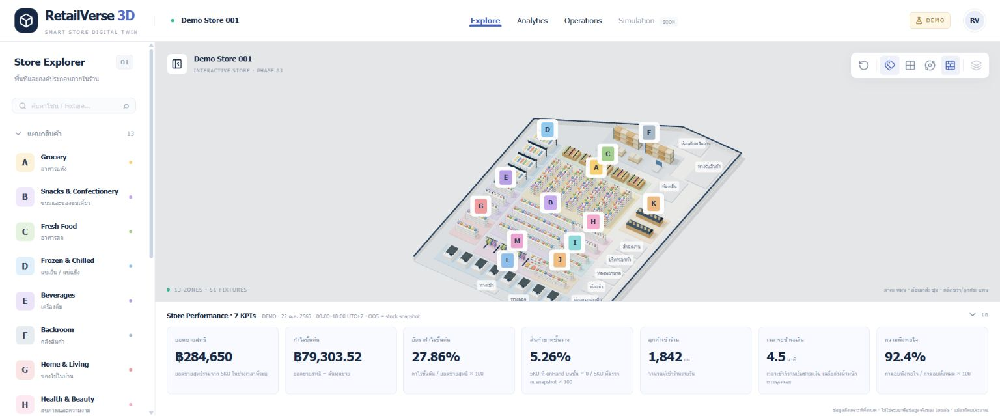

# RetailVerse 3D — Smart Store Digital Twin

RSIP (Retail Store Intelligence Platform), Phase 3 interactive retail analytics workspace. All figures, inventory and customer traffic are **synthetic mock data**. This is not a real Lotus's system and uses no Lotus's operational data. Floor-plan coordinates approximate the user-supplied image; they are neither an exact tracing nor a measured building survey.

## Run locally

Use Node.js 20.9+ (verified with Node 24.20.0) and npm.

```powershell
cd D:\net10\RSIP\RSIP
npm ci
npm run dev
```

Open http://localhost:3000. For a production preview:

```powershell
npm run build
npm start
```

WebGL is required for the scene; the explorer and dashboard remain available through the scene fallback. No API keys, environment files, backend or database are required. If a restricted Windows sandbox blocks the compiler's local worker sockets, run these commands from a normal project terminal.

## Features and layout



- Thai-first fullscreen `100dvh` workspace with fixed navbar, internal explorer scroll, full remaining-space canvas, collapsible right drawer with Overview / Inventory / Analytics tabs and collapsible seven-KPI store strip. The document does not scroll. Mobile uses a bottom drawer with separate space for the model.
- Thirteen zones A–M with 51 detailed, selectable fixtures: multi-tier product shelves, produce bins, glass refrigerators, warehouse racks/pallets/trolley, bakery counters, eight checkout/POS stations and apparel racks with hanging clothes, folded clothing and shoes. The Phase 1 zone coordinates are unchanged.
- Orthographic OrbitControls with drag rotation, wheel zoom, right-drag pan, smooth synchronized camera/target focus, reset, labels, grid, walls and auto rotation. After focusing the canvas, arrow keys also pan. Manual camera input or selection stops auto rotation; manual input interrupts a focus transition.
- Hover for cursor/outline/tooltip. Click a model to select without moving the camera; select in the explorer or press Focus Camera to animate toward it. Empty-space click or inspector Close clears selection without resetting the view. Search matches Thai/English names, IDs and fixtures. Groups expand/collapse.
- Inspector shows daily sales, profit/margin, shelf OOS and stock from provider records; checkout fixtures show weighted wait KPIs/history and explain why inventory planning is not applicable. Missing data displays `No Data`.
- Inventory planning offers SKU-linked demand, lead time, safety stock, available/incoming stock and arrival timing. Results show formula, substitution, units and assumptions. Forms update immediately and reset to Demo without modifying actual mock KPIs or the camera.
- Analytics Studio has eight modules: Retail KPI, dashboard/charts, pivot-like data exploration, inventory planning, retail operations, customer experience, contribution A/B comparison and action planning. Daily/rolling-weekly zone/category/fixture filters drive actual dataset charts; normal priorities and safety/legal critical queues are separate.
- Loading, WebGL and render-error fallbacks; browser-only lazy scene import (`ssr: false`).
- A single mock source accessed through an asynchronous provider, shared domain types, analytics and simulation contracts. Store/zone/fixture snapshots include units, definitions, source and period (Asia/Bangkok).

## Structure

```text
src/
  app/                   App Router entry, layout, errors, global styling
  components/
    analytics/           Forms, chart components, exploration and action planning
    layout/              Workspace and navbar
    scene/               Canvas, geometry, controls, toolbar, error boundary
      fixtures/          Reusable, memoized fixture model families
    panels/              StoreExplorer and ObjectInspector
    dashboard/           Collapsible store KPI strip
  config/                Editable floor plan and camera defaults
  data/mock/             Canonical sales facts, inventory, planning and service records
  data/providers/        RetailDataProvider and page data loader
  stores/                Zustand explorer and toolbar state
  lib/analytics/         Pure calculators, validation, selectors, aggregation and insights
  lib/scene/             Object lookup and camera framing math
  lib/simulation/        Simulation parameters and engine contract
  types/                 Shared domain models
tests/                   Data integrity and provider checks
docs/                    Phase 1/2/3 delivery reports and screenshots
```

## Dependencies (installed versions)

Next.js 16.4.2, React / React DOM 19.3.1, TypeScript 5.9.3, Tailwind CSS / PostCSS plugin 4.3.3, Three.js 0.180.0, React Three Fiber 9.8.2, Drei 10.7.9, Zustand 5.0.15, Recharts 3.10.1 and Lucide React 0.548.0. ESLint 9.39.5 + eslint-config-next 16.4.2; tsx for data tests; Prettier for source formatting. The lockfile records exact resolved dependencies. No legacy peer-dependency overrides were needed.

## Verification

```powershell
npm run typecheck
npm run lint
npm test
npm run build
```

24 tests cover all main formulas, zero/invalid/boundary/overflow cases, NPS total validation, inventory arrival timing, chart/pivot/KPI reconciliation, critical action separation, unchanged object relationships and the Phase 2 floor/camera contracts. See [Phase 3 report](docs/PHASE3.md) for the baseline, changed data definitions and browser evidence. Earlier [Phase 2](docs/PHASE2.md) and [Phase 1](docs/PHASE1.md) reports remain available.

## Analytics definitions

The canonical provider supplies 14 days (9–22 October 2026) of synthetic sales in integer cents, current inventory, planning assumptions, store context and checkout wait records. Cards and charts derive from those records. Current daily store sales are ฿284,650; gross profit and OOS have been recalculated rather than retaining Phase 2 placeholders. All displayed money uses up to two decimal places.

Daily means the latest demo day. Weekly means the last seven demo days, not a calendar week. Historical trend charts label their separate history window explicitly. OOS means shelf `onHand = 0` / checked merchandise SKU count at the current stock snapshot; backroom availability does not remove a shelf stockout. CSAT uses satisfied / responses. NPS is a signed score. Checkout wait is weighted by transactions.

Calculators are local scenarios. Division by zero yields `N/A`; invalid/empty/negative/non-finite values show validation, including response-count and percentage bounds. Very large values outside JavaScript's safe-number range and unsafe results are rejected. Incoming stock counts only if its arrival falls within the entered lead-time window. The simple planning formula does not incorporate reorder cycle, MOQ, supplier uncertainty or demand variability and never creates an actual order.

## Extending safely

Edit `src/config/floor-plan.ts` for zones/boundary and `src/config/fixtures.ts` for repeated fixture layouts. Floor lies on XZ; Y is height. Fixture layout offsets derive from the parent zone center; positions are not copied into components. Layout `size` includes height; the fixture's center is at `height/2 + 0.15`, above the zone floor. All objects have stable IDs; support IDs use `support-` and fixtures use `fixture-` prefixes. Keep fixture layout order stable if IDs have downstream consumers.

Zustand `selectedId` is the single selected-object state. `select(id)` requests focus for sidebar selection; `select(id, false)` selects in the scene without a camera move. `focusVersion` permits refocusing an already-selected object. `resetVersion` requests whole-store framing. Geometry/materials are shared through SceneAssets and disposed on scene unmount; repeated furniture and products use instancing. No per-frame React state updates or geometry allocation.

To use ASP.NET Core (.NET 10), implement `RetailDataProvider` with HTTP calls and replace the provider binding. UI components receive data via the page loader rather than importing mock records. Add the API and SQL Server only in a later phase.

## Known limits / Phase 4

Floor plan/models remain approximate and stylized. There are 40 representative mock SKUs, including two warehouse-only SKUs, rather than a complete retail catalog. Inspector content intentionally scrolls; outer Explore does not. Global analytics filters are independent of scene selection; Inspector analytics always use the selected object.

Scenario drafts are local: Inspector Inventory retains drafts across its tabs, but switching object/SKU resets its demo. Global module drafts and action edits reset when leaving their screen; there is no persistence, actual ordering or task assignment. Advanced chart animation, exports and custom chart configuration remain deferred. No backend, real inventory feeds, advanced statistical forecast, customer/queue/traffic simulation, heatmaps, AI recommendations, English locale switch or dark theme were added. No new dependencies were required.

`npm audit` on 21 October 2026 reports five high advisories in the **development-only ESLint chain**, rooted in `braces` through micromatch/fast-glob. npm suggests downgrading eslint-config-next to 14.x, which conflicts with this Next 16 foundation; no forced downgrade was applied. Production dependency audit is recorded separately in the delivery report. Review upstream patches before deploying a development service that accepts untrusted glob patterns.

Phase 3 stops here. Phase 4 must be explicitly requested; heatmaps and peak-time simulation have not been started.
