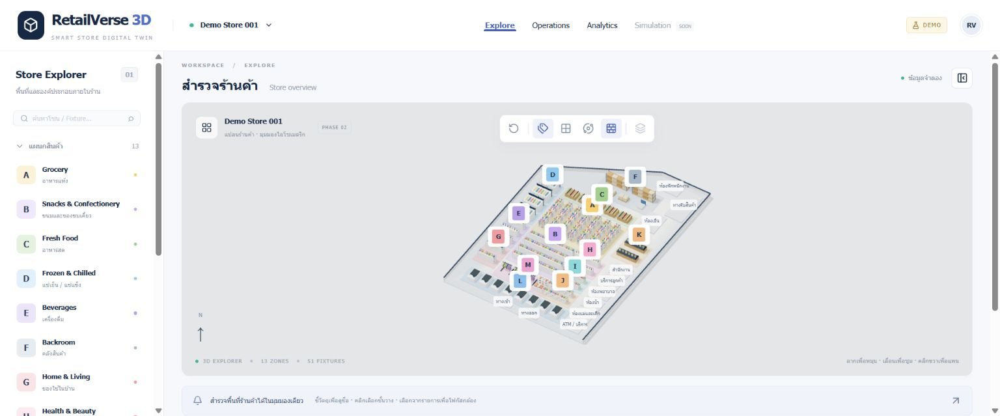

# RetailVerse 3D — Smart Store Digital Twin

RSIP (Retail Store Intelligence Platform), Phase 2 interactive isometric supermarket. All figures, inventory and customer traffic are **synthetic mock data**. This is not a real Lotus's system and uses no Lotus's operational data. Floor-plan coordinates approximate the user-supplied image; they are neither an exact tracing nor a measured building survey.

## Run locally

Use Node.js 20.9+ (verified with Node 24.20.0) and npm.

```powershell
cd D:\net10\RSIP\RSIP
npm ci
npm run dev
```

Open http://localhost:3000. For a production preview:

```powershell
npm run build
npm start
```

WebGL is required for the scene; the explorer and dashboard remain available through the scene fallback. No API keys, environment files, backend or database are required. If a restricted Windows sandbox blocks the compiler's local worker sockets, run these commands from a normal project terminal.

## Features and layout



- Thai-first navy/white workspace: top navigation, searchable left explorer, primary 3D canvas, floating toolbar, selection inspector and six KPI cards.
- Thirteen zones A–M with 51 detailed, selectable fixtures: multi-tier product shelves, produce bins, glass refrigerators, warehouse racks/pallets/trolley, bakery counters, eight checkout/POS stations and apparel racks with hanging clothes, folded clothing and shoes. The Phase 1 zone coordinates are unchanged.
- Orthographic OrbitControls with drag rotation, wheel zoom, right-drag pan, smooth synchronized camera/target focus, reset, labels, grid, walls and auto rotation. After focusing the canvas, arrow keys also pan. Manual camera input or selection stops auto rotation; manual input interrupts a focus transition.
- Hover for cursor/outline/tooltip. Click a model to select without moving the camera; select in the explorer or press Focus Camera to animate toward it. Empty-space click or inspector Close clears selection without resetting the view. Search matches Thai/English names, IDs and fixtures. Groups expand/collapse.
- Inspector shows metadata, type, mock sales/OOS and shelf/backroom stock from the existing provider; unavailable values display `No Data` rather than invented numbers.
- Analytics navigation displays a Recharts mock hourly traffic chart. Operations is a preview. Simulation and analytic layers remain explicitly unavailable.
- Loading, WebGL and render-error fallbacks; browser-only lazy scene import (`ssr: false`).
- A single mock source accessed through an asynchronous provider, shared domain types, analytics and simulation contracts. Store/zone/fixture snapshots include units, definitions, source and period (Asia/Bangkok).

## Structure

```text
src/
  app/                   App Router entry, layout, errors, global styling
  components/
    layout/              Workspace and navbar
    scene/               Canvas, geometry, controls, toolbar, error boundary
      fixtures/          Reusable, memoized fixture model families
    panels/              StoreExplorer and ObjectInspector
    dashboard/           KPI cards and hourly traffic chart
  config/                Editable floor plan and camera defaults
  data/mock/             Synthetic KPIs, inventory and hourly traffic
  data/providers/        RetailDataProvider and page data loader
  stores/                Zustand explorer and toolbar state
  lib/analytics/         KPI formatting and calculator contract
  lib/scene/             Object lookup and camera framing math
  lib/simulation/        Simulation parameters and engine contract
  types/                 Shared domain models
tests/                   Data integrity and provider checks
docs/                    Phase 1/2 delivery reports and screenshots
```

## Dependencies (installed versions)

Next.js 16.4.2, React / React DOM 19.3.1, TypeScript 5.9.3, Tailwind CSS / PostCSS plugin 4.3.3, Three.js 0.180.0, React Three Fiber 9.8.2, Drei 10.7.9, Zustand 5.0.15, Recharts 3.10.1 and Lucide React 0.548.0. ESLint 9.39.5 + eslint-config-next 16.4.2; tsx for data tests; Prettier for source formatting. The lockfile records exact resolved dependencies. No legacy peer-dependency overrides were needed.

## Verification

```powershell
npm run typecheck
npm run lint
npm test
npm run build
```

Seven tests verify IDs and relationships, fixture containment/non-overlap, required apparel models, camera framing/zoom limits, selection/focus/clear semantics, traffic reconciliation and missing-data provider behavior. Production Chrome QA covers rendering, selection, search, controls and runtime logs. See [Phase 2 delivery report](docs/PHASE2.md) for results and limits; [Phase 1 report](docs/PHASE1.md) preserves the original foundation record.

## Extending safely

Edit `src/config/floor-plan.ts` for zones/boundary and `src/config/fixtures.ts` for repeated fixture layouts. Floor lies on XZ; Y is height. Fixture layout offsets derive from the parent zone center; positions are not copied into components. Layout `size` includes height; the fixture's center is at `height/2 + 0.15`, above the zone floor. All objects have stable IDs; support IDs use `support-` and fixtures use `fixture-` prefixes. Keep fixture layout order stable if IDs have downstream consumers.

Zustand `selectedId` is the single selected-object state. `select(id)` requests focus for sidebar selection; `select(id, false)` selects in the scene without a camera move. `focusVersion` permits refocusing an already-selected object. `resetVersion` requests whole-store framing. Geometry/materials are shared through SceneAssets and disposed on scene unmount; repeated furniture and products use instancing. No per-frame React state updates or geometry allocation.

To use ASP.NET Core (.NET 10), implement `RetailDataProvider` with HTTP calls and replace the provider binding. UI components receive data via the page loader rather than importing mock records. Add the API and SQL Server only in a later phase.

## Known limits / Phase 3

Floor plan and dimensions are approximate; models are stylized and procedural, not photorealistic. Close-up focus intentionally crops neighboring departments. Compact labels may overlap at distant zoom; hide labels or zoom in. Inspector details scroll on short screens. No customer agents, queue/traffic simulation, heatmaps, AI recommendations, production calculators, backend, live inventory, persistence, English locale switch or dark theme. No new dependencies were required for Phase 2.

`npm audit` on 21 October 2026 reports five high advisories in the **development-only ESLint chain**, rooted in `braces` through micromatch/fast-glob. npm suggests downgrading eslint-config-next to 14.x, which conflicts with this Next 16 foundation; no forced downgrade was applied. Production dependency audit is recorded separately in the delivery report. Review upstream patches before deploying a development service that accepts untrusted glob patterns.

Phase 2 stops here. Phase 3 must be explicitly requested.
