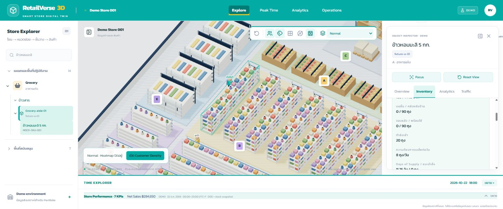
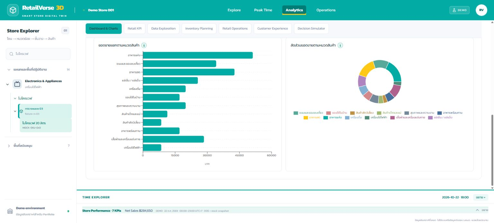

# RetailVerse 3D — Retail Store Intelligence Portfolio

This project is an independent portfolio demonstration using synthetic data. It is not affiliated with or endorsed by Lotus's.

RetailVerse connects an interactive 3D store to product categories, individual SKUs, inventory, calculators and retail analytics. The floor plan is an approximate interpretation of a reference image, not a measured building survey. All products, brands, inventory, sales, customer traffic and characters are fictional.

## Quick start

Use Node.js 20.9+ and npm (verified with Node 24.20.0).

```powershell
cd D:\net10\RSIP\RSIP
npm ci
npm run dev
```

Open [the development app](http://localhost:3000). `package.json` is inside the second RSIP folder. For a production preview:

```powershell
npm run build
npm run start -- --listen 3004
```

WebGL is required for the model; a fallback keeps the explorer and data accessible when WebGL is unavailable. No API keys, database, environment files or backend are needed. Kanit is downloaded from Google Fonts during the first build, then served locally. Both build modes use Next's supported webpack option after a Turbopack worker issue on this Windows environment. Restricted Windows sandboxes can block worker output directories or local sockets: build and preview from a normal project terminal. Stop the preview process before rebuilding its output.

## Cloudflare Pages

`npm run build` exports the complete demo into `out/`; no Node server is needed in production. Home query links (`/?view=analytics` and `/?view=peak`) are resolved in the browser, and the Operations route is exported with its own directory/index.html so direct visits and refreshes work.

Connect the GitHub repository to Pages with these settings:

| Setting | Value |
| --- | --- |
| Production branch | `feature/phase5-product-inventory` |
| Framework preset | Next.js (Static HTML Export), or None |
| Build command | `npm run build` |
| Build output directory | `out` |
| Root directory | Empty (repository root) |

No environment variables are required. The Pages URL uses HTTPS. Operations edits remain temporary browser state; this deployment does not add persistent storage. If a build says `Output directory "out" not found`, check both the selected branch and that the static-export commit is present before retrying.

## Product and inventory integration

The explorer uses shared Font Awesome category icons and an expandable hierarchy:

**Category → Subcategory → Product**

There are 12 retail departments, 44 subcategories and 52 unique active SKUs. Grocery has six subcategories and ten SKUs, including jasmine rice, white rice, instant noodles, cooking oils and seasoning. Backroom F stores these same merchandise SKUs by warehouse location. Checkout L connects to six POS transaction records; neither operational zone invents products to sell.

`RetailDataProvider.getCatalog()` exposes typed `CatalogCategory`, `Product`, `FixtureProduct`, `ShelfInventory`, `StockLocation` and `ProductPlanning` records. Categories have parent and zone IDs. Products carry fictional names, units, prices and costs. Display stock is keyed by SKU + fixture; warehouse/reserved/incoming quantities are keyed by SKU + storage location. Warehouse inventory is aggregated once even when a SKU has multiple displays. Stock summaries group by unit, so kilograms, bottles and bags are never added into one meaningless quantity. Existing merchandise SKU and fixture IDs remain stable.

Catalog validation catches duplicate identities, missing references, invalid capacity, negative/non-finite quantities and invalid reservations. The existing inventory API remains a compatibility view over canonical catalog stock; analytics and heatmaps derive from the same records. Current SKU placements each use one display and one warehouse location; multi-display aggregation is additionally covered by a test fixture.

Selecting a zone shows subcategories, SKU/OOS counts, sales KPIs and stock grouped by unit. Selecting a fixture shows its products and availability. Selecting a SKU focuses its fixture and opens product detail and the existing calculator, initialized with its stock and demand. Inspector daily KPIs and analytics can be scoped to the SKU. Product lists offer search, subcategory and availability filters.

## Calculators and analytics

Inputs are editable local scenarios and never modify actual mock records. Every result includes formula, substitution, unit and assumptions, with Reset Demo. Available stock excludes reserved quantities; incoming stock is counted only when it arrives within lead time. The SKU planner initializes Incoming and Arrival from the storage records. If future locations have mixed arrival dates, it uses an explicitly labelled eligible total with Arrival 0. Zero demand gives Days of Supply = N/A.

- Inventory: lead-time demand, target stock, suggested order and days of supply.
- Retail: foot traffic, conversion, basket value, sales, gross profit and margin.
- Operations: shelf OOS, waste, sales per labor hour and labor cost ratio.
- Experience: CSAT, signed NPS and complaint rate.
- Decision comparison: incremental contribution for two scenarios.
- Exploration: daily/rolling-weekly grouping and filters by zone, root category and SKU.

KPI headers reuse `KPIFieldHeader`: label and information icon remain together; units can sit at the right edge. Thai help dialogs explain meaning, formula, inputs, examples, interpretation and cautions. Chart help describes axes, units and color meanings. Sales trend, category bar, composition donut and hourly/zone charts have Thai titles, category names, labels, tooltips and units. Financial formulas remain unchanged.

Daily sales are ฿284,650. Gross profit is derived as ฿77,254.00; splitting fixture sales across more SKU rows changes rounding by ฿0.04 from the preceding build. Shelf OOS is 2/52 = 3.85%, reflecting a larger checked catalog. Daily figures are distinct from the selected-hour strip and calculators. The sales facts allocate integer cents across 14 demo days; subcategory IDs live in the catalog while legacy sales `categoryId` remains the root department for compatibility.

## 3D architecture and performance

Fourteen zones A–N contain 53 fixtures. Zones B and M are narrowed and their fixtures rearranged to leave a one-unit aisle beside H/I/J; other zone transforms remain. There are six checkout models, four colored ATMs, an electronics department with TV/fridge/microwave displays, receiving-aligned Cold Room, parked/moving carts and EAS gates. Office, Customer Service, First Aid and Baby Care support rooms are removed; the Baby & Kids merchandise department remains.

React Three Fiber renders the scene with shared geometry/materials and instanced repeated furniture parts. Six customers and three staff use obstacle-aware waypoint paths, basic walking and attached carts. Two sliding doors react to people. Animation uses refs and frame callbacks; no per-frame React state or model per SKU. Pixel ratio is capped. Analytics tabs overlay the mounted Canvas, preserving camera/animation state. Drei Html labels are contained beneath dialogs and page overlays by an isolated stacking context.

Scene selection and SKU context use the existing explorer store. Spatial date/hour/playback and visual people pause remain independent. Camera rotation, zoom, pan, focus and reset stay available. The browser demonstrates movement; no animation video or static substitute is used. No hardware-independent FPS benchmark is claimed.

## Heatmap and peak time

Normal, Customer Density, Sales Intensity and OOS Risk share the floor-plan transforms and spatial provider. Three demo days (20–22 October 2026), 15 buckets per day, selected-hour chart markers, derived peak time, legend and Inspector update together. Daily and hourly sales/traffic/transaction totals reconcile. Occupancy is a simultaneous zone snapshot, not a sum of visits; density uses explicitly mock square metres.

Time Explorer supports date/hour, slider, Play/Pause/Reset, speed and collapse/expand without resetting time or camera. Playback stops at the final bucket (22:00–23:00). Visual characters do not drive business KPI values.

## Operations

[Action Planning](http://localhost:3004/operations/action-planning) is a dedicated page, separate from Analytics. Add/edit actions, update status, filter by zone/status and sort normal priorities. Safety/legal critical items stay in a separate queue. Data is local to the mounted page, resets when leaving/reloading, and is not saved to a backend or sent to another person.

## Ten-step demo

1. Select อาหารแห้ง in Store Explorer.
2. Expand ข้าวสาร.
3. Select ข้าวหอมมะลิ 5 กก. directly from the numbered product list (MOCK-SKU-001). All departments use category → subcategory → products, without a fixture level.
4. Inspect shelf 0, warehouse 90 bags, incoming 20; shelf OOS remains true despite warehouse stock.
5. Change Daily Demand from 8 to 100 bags/day.
6. Suggested Order becomes 205 bags and Days of Supply 0.9 days (available 90, lead time 3, safety 15, eligible incoming 20). Reset Demo restores the SKU defaults.
7. Turn on Customer Density; change the hour and open Peak Time.
8. Open Analytics to view Thai sales trend, category bar and composition donut.
9. Click an information icon to read the formula and interpretation.
10. Open Operations → Action Planning and demonstrate a local action/status/filter.

## Tech stack and structure

Next.js 16.4.2 App Router, React 19.3.1, TypeScript 5.9.3, Three.js 0.180.0, React Three Fiber 9.8.2, Drei 10.7.9, Zustand 5.0.15, Recharts 3.10.1, Font Awesome category icons, Lucide React controls and Tailwind CSS 4. No backend framework was added.

- `src/config`: editable floor plan, fixtures, environment paths, heatmap thresholds and help definitions.
- `src/types/catalog.ts`: product, mapping, stock and planning contracts.
- `src/data/mock/catalog.ts`: canonical synthetic catalog and stock locations.
- `src/data/providers`: asynchronous provider seam for a future .NET API / SQL Server implementation.
- `src/lib/analytics`: pure formulas, catalog validation/aggregation, sales and spatial selectors.
- `src/components/panels`: explorer tree, catalog browsing and Inspector.
- `src/components/analytics`: reusable field headers, calculator, help dialogs, tables and charts.
- `src/components/scene`: geometry/models, controls, interaction and frame-based animation.
- `src/stores`: independent explorer, spatial and visual environment state.
- `tests`: domain, reference integrity, invalid-input, reconciliation, path and state regressions.

## Verify

```powershell
npm run typecheck
npm run lint
npm test
npm run build
```

See [Phase 5 delivery report](docs/PHASE5.md) for counts, file changes, browser evidence and limitations. The previous [store enhancement report](docs/STORE-ENHANCEMENT.md) and Phase 1–4 reports describe their historical snapshots.

## Screenshots




## Known limitations and roadmap

Synthetic representative products are not a complete catalog. Financial facts and demand are independent illustrative inputs, not a sales forecasting model. There are no persisted inventory edits, real orders, task assignment, authentication, live ERP feeds, .NET API or SQL Server. Action state resets on navigation. Warehouse reservation and multi-display models are supported and tested, but the shipped demo uses zero reservations and one display/storage location per SKU.

Basic path yielding is not continuous crowd physics; realistic queues, KPI-driven character behavior and detailed animation remain P2. Floor geometry is approximate. A GPU/FPS benchmark has not been measured. Further work can add API persistence, measured floor plans, forecasting and crowd behavior after the data contracts are implemented server-side.

The local optimized Next.js build is the portfolio delivery target. Hosting requires a supported Next.js/Node environment because the main route uses server rendering. Authentication, dependency/security review and real-data handling require separate work before using this with operational data. Production deployment has not been performed.
