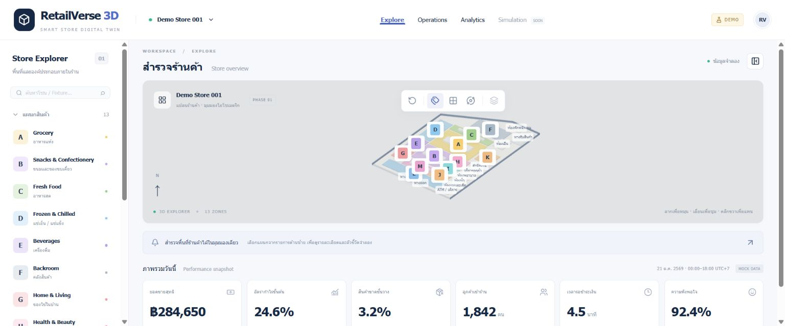

# RetailVerse 3D — Smart Store Digital Twin

RSIP (Retail Store Intelligence Platform), Phase 1 portfolio foundation. All figures, inventory and customer traffic are **synthetic mock data**. This is not a real Lotus's system and uses no Lotus's operational data. Floor-plan coordinates approximate the user-supplied image; they are neither an exact tracing nor a measured building survey.

## Run locally

Use Node.js 20.9+ (verified with Node 24.20.0) and npm.

```powershell
cd D:\net10\RSIP\RSIP
npm ci
npm run dev
```

Open http://localhost:3000. For a production preview:

```powershell
npm run build
npm start
```

WebGL is required for the scene; the explorer and dashboard remain available through the scene fallback. No API keys, environment files, backend or database are required. If a restricted Windows sandbox blocks the compiler's local worker sockets, run these commands from a normal project terminal.

## Features and layout



- Thai-first navy/white workspace: top navigation, searchable left explorer, primary 3D canvas, floating toolbar, selection inspector and six KPI cards.
- Thirteen colored zones A–M, including Clothing & Apparel before the checkout; eleven independently identified support/entrance areas; slanted northern building boundary.
- Orthographic camera, OrbitControls, responsive camera fit, reset, labels, grid and auto rotation.
- Select a zone, fixture or support area in the explorer to inspect its metadata. Search matches Thai/English names, IDs and fixtures. Groups expand/collapse.
- Analytics navigation displays a Recharts mock hourly traffic chart. Operations is a preview. Simulation and layers are explicitly unavailable in Phase 1.
- Loading, WebGL and render-error fallbacks; browser-only lazy scene import (`ssr: false`).
- A single mock source accessed through an asynchronous provider, shared domain types, analytics and simulation contracts. Store/zone/fixture snapshots include units, definitions, source and period (Asia/Bangkok).

## Structure

```text
src/
  app/                   App Router entry, layout, errors, global styling
  components/
    layout/              Workspace and navbar
    scene/               Canvas, geometry, controls, toolbar, error boundary
    panels/              StoreExplorer and ObjectInspector
    dashboard/           KPI cards and hourly traffic chart
  config/                Editable floor plan and camera defaults
  data/mock/             Synthetic KPIs, inventory and hourly traffic
  data/providers/        RetailDataProvider and page data loader
  stores/                Zustand explorer and toolbar state
  lib/analytics/         KPI formatting and calculator contract
  lib/simulation/        Simulation parameters and engine contract
  types/                 Shared domain models
tests/                   Data integrity and provider checks
docs/PHASE1.md            Phase 1 delivery and floor-plan report
```

## Dependencies (installed versions)

Next.js 16.4.2, React / React DOM 19.3.1, TypeScript 5.9.3, Tailwind CSS / PostCSS plugin 4.3.3, Three.js 0.180.0, React Three Fiber 9.8.2, Drei 10.7.9, Zustand 5.0.15, Recharts 3.10.1 and Lucide React 0.548.0. ESLint 9.39.5 + eslint-config-next 16.4.2; tsx for data tests; Prettier for source formatting. The lockfile records exact resolved dependencies. No legacy peer-dependency overrides were needed.

## Verification

```powershell
npm run typecheck
npm run lint
npm test
npm run build
```

The data tests verify unique IDs, all A–M zones, zone/category/fixture/inventory relationships, hourly traffic reconciliation and provider metadata. Browser QA covers rendering, selection, search, controls and runtime logs. See the delivery report for results and limitations.

## Extending safely

Edit `src/config/floor-plan.ts` to change geometry. Floor lies on XZ; Y is height. `transform(x,z,width,depth,height)` derives position and size. All objects have stable IDs; support IDs use `support-` and fixtures use `fixture-` prefixes. Scene components consume config without duplicating placements. Selected object ID in the Zustand store is the future camera-focus event seam.

To use ASP.NET Core (.NET 10), implement `RetailDataProvider` with HTTP calls and replace the provider binding. UI components receive data via the page loader rather than importing mock records. Add the API and SQL Server only in a later phase.

## Known limits / Phase 2

Floor plan and dimensions are approximate. Fixture blocks are representative placeholders, not detailed aisles. No direct scene picking, smooth focus, detailed shelves/refrigerators/checkouts, production calculators, backend, live inventory, persistence, English locale switch or dark theme. Compact labels may overlap at distant zoom; hide labels or zoom in.

`npm audit` on 21 October 2026 reports five high advisories in the **development-only ESLint chain**, rooted in `braces` through micromatch/fast-glob. npm suggests downgrading eslint-config-next to 14.x, which conflicts with this Next 16 foundation; no forced downgrade was applied. Production dependency audit is recorded separately in the delivery report. Review upstream patches before deploying a development service that accepts untrusted glob patterns.

Phase 1 stops here. Phase 2 must be explicitly requested.
