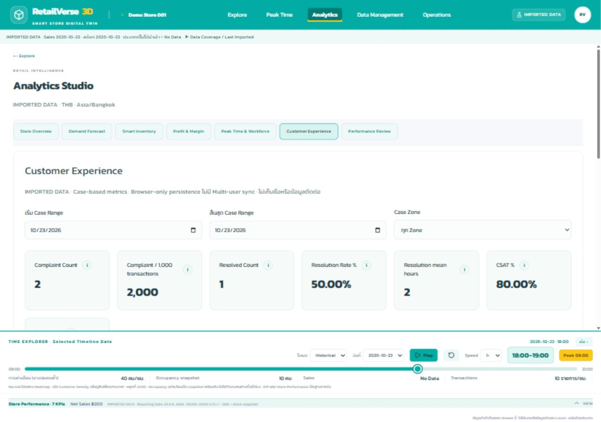
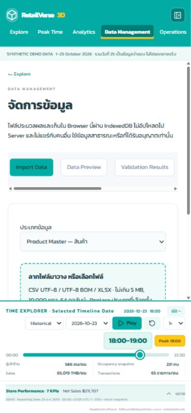
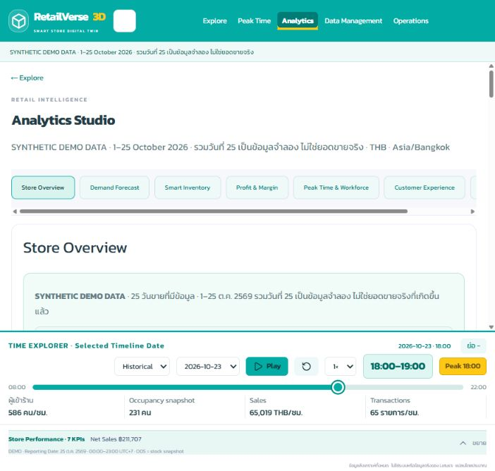

# รายงาน Full Analytics 7-page Audit, Bug Fix & Integration

วันที่ตรวจ: 24–25 ตุลาคม 2569 · Repository RSIP เดิม · Production: https://rsip.pages.dev/?view=analytics

## 1. Audit Results

| Page | Existing Issues | Fixed | Remaining | Status |
|---|---|---|---|---|
| Store Overview | ไม่มี Reset; วันที่ Timeline กับรายงานไม่บอกบริบท; OOS หลังรายงานยังอ่าน snapshot เดิม | Reset/Active Filters; ป้าย Selected Timeline Date และ Reporting Date; approved snapshot ใช้ร่วมกัน; ยืนยันทุกโหมดเวลา | Coverage จำกัดตามข้อมูลนำเข้า | PASS |
| Demand Forecast | กราฟเฉพาะ Forecast; ไม่มี category/baseline/top SKU | Historical/Forecast line แยกเส้น; category aggregation; quantity/revenue/change/top5; snapshot เก็บตัวเลือก SKU/category | เป็น assumption model ไม่ใช่การยืนยันความแม่นยำ | PASS |
| Smart Inventory | ETA ไม่ชดเชยวันเริ่มแผนที่ห่าง snapshot; backtest เสี่ยงอ่าน stock อนาคต; Review days ไม่ส่งต่อ Profit | เทียบวัน ETA; ไม่ใช้ stock อนาคต; Review days ร่วมใน store; แยก refill/order; Focus Fixture เดิม | ยอดปิดเป็นประมาณการรวมช่วง ไม่ใช่ stock-flow รายชั่วโมง | PASS |
| Profit & Margin | แก้ราคา/ทุน/quantity ไม่ได้; ไม่มีเทียบ Margin; invalid Review ข้ามหน้าเสี่ยง error | Scenario inputs; Margin/Contribution comparison; อ่าน Workforce task cost ตาม Zone/ช่วง; จับ invalid input | Timely planned order เป็นสมมติฐานที่ผู้ใช้เลือก | PASS |
| Peak Time & Workforce | มีเพียงสามวัน; ranking เฉพาะชั่วโมง | 21 วัน/3 สัปดาห์; peak day/hour/categories/workload/action; context Cell; shared heatmap/Timeline; task มีต้นทุน | Forecast มีเฉพาะ horizon ที่เลือก ที่เหลือ No Data; occupancy ใช้เป็น proxy | PASS |
| Customer Experience | ไม่มีตัวกรอง/ปิดเคส; feedback ปะปน reference; hydrate คอลัมน์ optional หาย | Date/Zone filters; case KPIs; linked Action/status/resolution; reference scope; CSV refresh repair | ไม่มี case ใน Demo จะแสดง No Data; CSAT มีเฉพาะ survey ระดับร้าน | PASS |
| Performance Review | Actual comparison ใช้ logic เก่าซ้ำ; ไม่มี variance %/margin/export | Reuse StoreOverview; frozen snapshot vs actual; row variance %/weighted margin/category; CSV; source references/coverage | Confirmed Closing/Waste ต้องนำเข้าจริง ไม่อนุมาน | PASS |

PASS หมายถึงตรวจพฤติกรรมภายใต้ขอบเขต Browser demo และข้อจำกัดที่ระบุ ไม่ใช่การรับรองระบบใช้งานจริงหลายคน

Acceptance checklist (ตามขอบเขตและหลักฐานข้อ4/7/10):

| ข้อ | ผล | หลักฐาน |
|---|---|---|
| 1–2: 7 Analytics / 5 navigation | PASS | Browser desktop/mobile |
| 3–4: 25วัน / source switchไม่ลบไฟล์ | PASS | Tests + browser source switch/refresh |
| 5–8: date modes / filters / charts | PASS | Overview suite + Browser ทุกโหมด |
| 9: Info | PASS | เปิด popover ครบ7หน้า; measured flex; keyboard Escape |
| 10–13: forecast/inventory/profit/COGS | PASS | Engine/provider tests + เปลี่ยน inputsจริง |
| 14–16: peak/workforce/3D | PASS | Spatial tests + Browser Focus/Inspector/Timeline |
| 17–19: cases/review/operations | PASS | CSV import + case/action close + task/report flow + frozen variance |
| 20: Data Management spacing | PASS | Desktop28/card24; mobile16/card24; no overlap |
| 21–22: no silent demo/missing/nonfinite | PASS | Provider/validation/zero denominator regression suites |
| 23: responsive | PASS | เปิด7tabที่390px ไม่มี page overflow |
| 24: TypeScript/tests/build | PASS | 148 tests; typecheck/lint/build |
| 25: scene/navigation regression | PASS | Geometry untouched; existing floorplan/spatial tests + 3D focus browser |

## 2. Root Causes

- IndexedDB hydrate ใช้ชื่อคอลัมน์จากแถวแรกเท่านั้น ทำให้ `resolvedAt` ในแถวถัดไปถูกทิ้ง เมื่อกู้ข้อมูลจะพบ Done ไม่มีเวลาปิดเคส ทั้งที่ Import รอบแรกผ่าน แก้เป็น union ของคอลัมน์ทุกแถว พิสูจน์ด้วย CSV จริงสองแถวและ test กู้ข้อมูล
- Approved Quick Report ปรับ catalog/spatial แต่ไม่ปรับ dated inventory view ที่ Overview อ่าน แก้ derived view โดยไม่เปลี่ยน saved import หรือธุรกรรมขาย
- ETA เป็นจำนวนวันจาก snapshot แต่ comparator เดิมถือว่าวันเริ่ม forecast เป็นวันถัดไปเสมอ แก้ offset และป้องกัน snapshot ภายหลังเข้า backtest รวมวัน Bangkok ของ timestamp รายงาน
- Review ใช้ Overview รุ่นเก่าที่มีสูตร/ช่วง/stock ต่างจากหน้าหลัก ลบ implementation ซ้ำและ reuse component เดิม
- Customer ไม่มี case/action identity ที่เชื่อมสถานะกัน เพิ่มข้อมูลใน workflow store เดิม; ปิด Action แล้ว sync สถานะและ resolvedAt; feedback ใหม่มี dataset reference และไม่แสดงของเก่าที่ไม่รู้แหล่งรวมกัน
- Field ที่มีปุ่ม i อยู่ใน label ทำให้ accessible name ของ input ไม่ชัด เพิ่ม aria-label ตรงชื่อช่อง

## 3. Data Integrity

- ทุกหน้ารับ DashboardData จาก Active Dataset เดิม ไม่สร้าง Provider ใหม่; October 1–25 ยัง 65 SKU, 25 วัน และ labels SYNTHETIC รวมวันที่ 25 ชัดเจน
- ยอดขายและ COGS มาจาก transaction cents; margin ใช้ผลรวม GP / ผลรวม sales; Scenario เปลี่ยน inputs เฉพาะการจำลอง ไม่ revalue ธุรกรรมเก่า
- Shelf นับระดับ SKU/Fixture; warehouse นับระดับ SKU/location ครั้งเดียว; stock ไม่บวกหลายวัน; Incoming นับตาม ETA
- Replenishment จำกัดคลังพร้อมใช้และพื้นที่ชั้น; Suggested Order หัก available และ eligible incoming; Stock Investment แยก COGS
- Frozen forecast ไม่คำนวณใหม่เมื่อ import actual; reference และ createdAt แสดงใน Review; actual ที่ไม่มีเป็น No Data; forecast ศูนย์ใช้ N/A สำหรับ variance %
- Cases ไม่บวก Experience aggregate ซ้ำ; complaint rate ใช้ transaction IDs ไม่ซ้ำในช่วง/Zone เดียวกัน; CSAT ใช้ survey responses เท่านั้น
- Workflow/Imported data เก็บใน IndexedDB ของ Browser นี้ ไม่อ้าง multi-user sync; การสลับ Demo เก็บ imported bundle ไว้

## 4. Cross-module Integration

| Workflow | วิธีตรวจและผล |
|---|---|
| Demo → 7 หน้า | Browser เปิดทุก tab; source October reference เดียวกัน; 25 วัน; input เริ่มต้นเป็นค่า date จริง |
| Date modes | Browser WTD 19–25/12–18; Same weekday21/14; Daily21/20; Weekly; Festival normal-day pairs; Custom; Reset Zone N กลับ All |
| Forecast → Inventory → Profit | Browser SKU เส้นหมี่เจและปัจจัย 50%, Optimistic, horizon3 เปลี่ยนรวม16→46หน่วย; SKU เดียวกันถูกส่งต่อ; สูตร/ETA/zero demand เพิ่ม test |
| Price/cost/sales import | Existing automated provider/import integration และ test ใหม่ยืนยันต้นทุนธุรกรรมย้อนหลังไม่ถูกเปลี่ยน; ไม่อ้างว่าอัปโหลดทุกชนิดผ่าน UI รอบนี้ |
| Inventory → 3D | Browser Focus เปิดเส้นหมี่เจ fixture-a-01; Inspector แสดง21/216; tests ตรวจ mapping/dedup/OOS; approved report เปลี่ยน Overview OOS9.23→7.69% |
| Traffic → Workforce/3D | Browser historical24.6 workload / capacity10 → required3/additional2/cost160; Forecast Zone A26ต.ค.18:00 occupancy16 ตรง Inspector/Timeline; Forecast entries/sales/transactions เป็น No Data |
| Workforce → Operations/Staff Hub | Browser สร้าง Reinforce task, My Tasks พบ ID เดิม; เปลี่ยน In progress; ส่ง Quick Report เชื่อม task; อนุมัติและปิดเคสแล้ว Task Done |
| Customer CSV → Action → Dashboard | อัปโหลด CSV2แถว ผ่าน2/error0/warning0 → preview→confirm; case count2/resolved1/50%/mean2h; filter checkoutเหลือ1; ก่อนหน้านั้นทดสอบ CASE001 Action In progress→Done ทำให้ Dashboard resolved1/100% และ refresh ยังอยู่ |
| Persistence | Browser refresh หลัง CSV เปิดได้โดยไม่ล้างข้อมูล หลังแก้ optional columns; automated test ยืนยัน source Imported และ resolvedAt ในแถว2ยังอยู่ |
| Review | Browser snapshot26–28ไม่มีActual; snapshotย้อนหลัง16ต.ค. SKU001 forecast2,960/actual2,932.25/GP623.45/margin21.26%; immutable rows และ CSV escaping ผ่าน tests |

## 5. UI / UX Fixes

- i ทุกหน้าที่เพิ่มใช้ popover เดิม มี accessible label, keyboard และ Escape; วัด inline-flex gap6px, center difference0 ในช่อง Forecast/summary
- Monetary/percentage summary cards ใช้รูปแบบร่วม, หน่วยและ source ชัดเจน; แยกบริบท timeline กับ reporting
- Browser 1280×900 และ390×844: เปิดทั้ง7หน้าไม่มี page horizontal overflow; ตารางเลื่อนภายใน; mobile navigation เป็น horizontal tabs
- Data Management desktop padding28/card24/gap16; mobile main16/card24 หลังแก้ override ที่เดิมเป็น16; Timeline อยู่ข้างนอก scroll container ไม่บังฟอร์ม
- ตรวจ Console error ใน local browser ระหว่าง walkthrough: ไม่พบ error

## 6. Files Modified

- `src/components/analytics/AnalyticsWorkspace.tsx`: ลบ legacy Overview; Forecast/category/chart/snapshot, shared inventory review, Profit scenario, Review variance/export
- `src/components/analytics/StoreOverview.tsx`: reset/active filters/summary formatting
- `src/components/analytics/WorkforcePanel.tsx`: three-week grid, weekly rank, selected context, workload task cost
- `src/components/analytics/CustomerPanel.tsx`: filters/case metrics/status/action/source
- `src/components/analytics/IntelligenceUI.tsx`, `src/lib/analytics/metric-help.ts`: formatting/help/accessible numeric fields
- `src/components/analytics/StaffHub.tsx`, `ActionPlanning.tsx`: task-report closure, scoped feedback, truthful persistence text
- `src/lib/analytics/customer.ts`: case selectors, Bangkok day, action-status reconciliation
- `src/lib/analytics/intelligence.ts`: ETA/date protection and review variance/margin
- `src/lib/analytics/operations.ts`: approved dated snapshot projection
- `src/stores/data-source.ts`: optional column refresh repair
- `src/stores/intelligence.ts`, `src/types/intelligence.ts`: additive workflow state, review period, snapshot metadata, task/report references
- `src/components/spatial/Timeline.tsx`, `src/components/dashboard/BottomDashboard.tsx`: date context labels
- `src/app/intelligence.css`: scoped info alignment/mobile card spacing
- `tests/analytics-audit.test.ts`: 17 regression tests
- `docs/analytics-7-page-audit.md`, report นี้: ก่อน/หลังและหลักฐาน

ไม่มีการแก้ geometry, Zone A–N หรือ Fixture coordinates

## 7. Test Results

- `npm test`: 148/148 PASS, 0 fail, 0 skipped (เดิม131 + ใหม่17)
- `npm run typecheck`: PASS
- `npm run lint`: PASS
- `git diff --check`: ตรวจไม่มี whitespace error
- ตรวจระหว่าง stages ด้วย original suites, intelligence/spatial/overview suites และ production builds; ไม่ลบ/skip tests เดิม
- ไม่มี Playwright/Cypress package เดิม จึงไม่เพิ่ม framework ซ้ำ ใช้ Browser interaction จริงผ่าน CUA และ pure/provider/persistence regression tests
- CSV import UI ผ่านจริง; XLSX parser/validation ตรวจผ่าน automated suite เดิม ไม่ได้อัปโหลด XLSX ผ่าน Browser ในรอบนี้

## 8. Build Results

Production static export ผ่าน: `/`, `/_not-found`, `/operations/action-planning` · ใช้ Next.js build เดิม · Cloudflare Pages check สำเร็จ (app commit db7495e) และ Browser ตรวจเว็บจริงครบ7tabs; ปรับ Scenario/Horizon แล้ว Forecast16→9และคืนค่าเดิม; Console error0

## 9. Git Status

Branch: `fix/analytics-integration-audit`

App commit: `db7495e8bb15b2a2166a87cd996aba4c39891c94`

Push สำเร็จไป `fix/analytics-integration-audit` และ production branch `feature/phase5-product-inventory` แบบ fast-forward ไม่ force push

Cloudflare Pages: completed / success · [Deployment](https://dash.cloudflare.com/?to=/865862ff8df66a060eedaf05759a2dcf/pages/view/rsip/a77a3aa3-0a02-44c8-be80-d4ab55caa8a9)

Live verified: https://rsip.pages.dev/?view=analytics · เปิดครบ7หน้าและเปลี่ยนForecast inputsบนเว็บจริง; ไม่เปลี่ยนข้อมูลนำเข้าใน production; commit ของรายงาน/ภาพตามหลัง app commit ไม่เปลี่ยน application source

## 10. Known Limitations

- Demo เป็นข้อมูลสังเคราะห์ ไม่ใช่ยอดขาย Lotus’s; มี25วัน ไม่เหมาะอ้าง seasonal accuracy; Forecast ±20% เป็นสมมติฐาน
- Capacity/service/extra labor และ occupancy-to-workload เป็น Scenario; ไม่มี roster หรือ traffic forecast ที่ผ่าน calibration
- Inventory/Profit ใช้ supply รวมตาม horizon ไม่จำลอง stockout รายชั่วโมง; ถ้า forecast start ห่าง snapshot แจ้งสมมติ opening stock คงเดิม
- ไม่มี case/zone survey/confirmed closing/waste จะไม่สร้างข้อมูลแทน; Overview stock ใช้วันที่สิ้นสุดตรงกัน; unknown coverage ไม่ตีความเป็นยอดลดลง
- ข้อมูลเก็บเฉพาะ Browser ไม่มี authentication จริงหรือ multi-user sync; Legacy feedback ไม่มี reference ถูกเก็บแต่ไม่ปนกับ active dataset
- E2E ที่บันทึกเป็น interaction walkthrough ไม่ใช่ automated UI runner; test source switch และ pipeline ใช้ทั้ง Browser + automated provider testsตามตารางข้อ4 ไม่อ้างว่าส่งทุกไฟล์ทุกชนิดผ่าน UI

## 11. Demo Walkthrough (10–15 นาที)

1. นาที0–2: Overview → ใช้ Demo → WTD19–25 vs12–18 → Same weekday21 vs14 → เปิด i และ Reset Filters
2. นาที2–4: Forecast เลือกเส้นหมี่เจ → 3/7วัน → Conservative/Optimistic → Festival override → ดูเส้นประวัติกับ forecast แล้ว Save Snapshot
3. นาที4–6: Inventory SKU เดียวกัน → อ่านเติมชั้น/สั่งเพิ่ม/ETA → Focus fixtureเดิม → Profit ปรับต้นทุน/ส่วนลด/ค่าแรง เปรียบ GP กับ Contribution
4. นาที6–8: Workforce อ่าน3สัปดาห์/peak rank → productive10 → required/additional → สร้างงาน → Focusวันที่/ชั่วโมงใน3D; Forecastไม่มีactualsales
5. นาที8–11: Operations My Tasks → In progress → Quick Reportเชื่อมงาน → อนุมัติ→ปิดเคส→Done
6. นาที11–13: Data Management นำเข้า Feedback CSV → validation/preview/confirm → Customer filterZone/date → สร้าง Action→Done→Dashboard; refreshตรวจ persistence
7. นาที13–15: Review เลือก frozen snapshot → ช่วงมี/ไม่มีactual → ดูvariance/margin/coverage→ExportCSV; สลับDemo/Importedเพื่อยืนยันไฟล์ยังอยู่

หลักฐานภาพ Browser:

