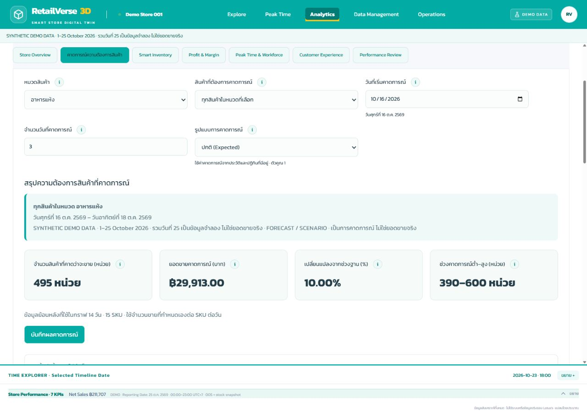
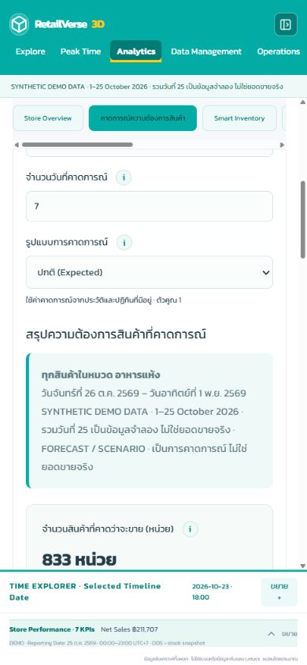

# รายงานปรับปรุงคาดการณ์ความต้องการสินค้า

ขอบเขต: หน้า Demand Forecast ใน RSIP เดิม และ shared integration ที่จำเป็น · 25 ตุลาคม 2569

## 1. ปัญหาที่พบจากโค้ดเดิม

- SKU กับ Category เป็น filter คนละชุด เลือกข้าวและหมวดมันฝรั่งพร้อมกันได้ ผลกราฟ/ตารางจึงอาจใช้คนละขอบเขตกับ SKU ที่เห็น
- Top5 แสดงทั้งร้านเสมอ แม้เลือก SKU เดียว และ Snapshot เก็บทุก SKU เสมอ ไม่ตรงกับหน้าจอ
- Cutoff/Manual/Override แสดงพร้อมกันทั้งหมด; 0% ใช้ทั้งแทน Automatic และตัวเลขสมมติฐาน
- ตัวเลือกและหัวข้อส่วนใหญ่เป็นอังกฤษ ไม่มีช่วงต่ำ–สูงใน summary และข้อมูล SKU จาก Inspector กับ planning อาจไม่ตรงกัน

## 2. วิธีแก้ Category/SKU ไม่สัมพันธ์กัน

- ใช้ scope เดียว `{categoryId, sku}` และแก้ผล/กราฟ/อันดับ/ตาราง/บันทึกจาก scope นี้
- หมวดมาจาก category hierarchy ของ Product Master; เปลี่ยนหมวดจะล้าง SKU และแสดงเฉพาะลูกหลานหมวดนั้น
- เลือก SKU จากทั้งร้านจะเลือกหมวดหลักที่สัมพันธ์ให้อัตโนมัติ; รับ SKU จาก Inventory/Inspector ตามการเลือกล่าสุด แล้วส่งต่อ shared planning selection
- ถ้าไม่พบ mapping แสดง Unmapped / error ไม่ใช้หมวดอื่นแทน
- เพิ่มเฉพาะ timestamp การเลือกใน stores เดิมเพื่อแยกลำดับ handoff ไม่เปลี่ยนรูปทรง ตำแหน่ง กล้อง หรือ renderer 3D

## 3. รายการหัวข้อที่เปลี่ยนเป็นภาษาไทย

ชื่อแท็บ/หน้า: **คาดการณ์ความต้องการสินค้า** พร้อมคำอธิบายตามคำขอ

ตัวเลือกหลัก: หมวดสินค้า, สินค้าที่ต้องการคาดการณ์, วันที่เริ่มคาดการณ์, จำนวนวันที่คาดการณ์, รูปแบบการคาดการณ์

ส่วนผลลัพธ์: สรุปความต้องการสินค้าที่คาดการณ์, จำนวนสินค้าที่คาดว่าจะขาย, ยอดขายคาดการณ์, เปลี่ยนแปลงจากช่วงฐาน, ช่วงคาดการณ์ต่ำ–สูง, ยอดขายย้อนหลังเทียบกับความต้องการที่คาดการณ์, รายละเอียดคาดการณ์รายวัน, 5 สินค้าที่คาดว่าจะขายดีที่สุด และบันทึกผลคาดการณ์

ส่วนขยาย: ตั้งค่าขั้นสูง (ไม่จำเป็น), ใช้ข้อมูลย้อนหลังถึงวันที่, ใช้สมมติฐานยอดขายเอง, จำนวนขายเฉลี่ยต่อ SKU ต่อวัน, ปรับยอดขายวันเสาร์–อาทิตย์, การปรับยอดขายช่วงเทศกาล/โปรโมชั่น และปฏิทินธุรกิจและปัจจัยที่มีผลต่อยอดขาย

## 4. Advanced Settings ที่เพิ่มหรือปรับ

- ปิดส่วนขยายเป็นค่าเริ่มต้น; ผู้ใช้ทั่วไปกรอกเพียง5ตัวเลือกหลัก
- ปิด Manual แล้วซ่อน units/day และ weekend input; เปิดแล้วแจ้งว่าเป็นจำนวน **ต่อ SKU ต่อวัน**
- เทศกาลและโปรโมชั่นมีโหมดอัตโนมัติ/กำหนดเองแยกจากตัวเลข 0% ไม่กลับไปใช้ Calendar
- Override ใหม่ใช้เฉพาะวัน/SKU ที่มี Calendar event ประเภทนั้น; ถ้าไม่มี event จะไม่มีผล มีคำอธิบายในหน้าจอ
- ตรวจ ISO date จริง, start หลัง cutoff, horizonจำนวนเต็ม1–7, ค่าตัวเลขไม่ติดลบ/ไม่ใช่ NaN/Infinity และขอบเขต0–10,000ตามโมเดลเดิม
- วันที่เริ่มแสดงคำอ่านไทยกำกับ input; ข้อมูลภายในยัง ISO

## 5. Forecast Calculation ที่ยังใช้จากของเดิม

ยังใช้ `demandForecast` และ `useForecast` เดิม: ฐานวันเดียวกันในสัปดาห์ย้อนหลังไม่เกิน4ครั้ง ตัดผลปฏิทินในอดีตออกก่อนใส่ผลเป้าหมายเพียงครั้งเดียว ปัดจำนวนขึ้นและคำนวณ revenue จากราคาปัจจุบันใน Product Master

Scenario ใช้ config ที่แยกจากตัวเลขเดิม: Conservative0.85 / Expected1 / Optimistic1.15; ไม่เปลี่ยน Actual Sales

Shared calendar helper ใช้ร่วมกับ workforce/spatial เพื่อให้ Manual0% มีความหมายเดียวกันทุก consumer ไม่ทำสูตรซ้ำ ค่า options/snapshot รุ่นเก่าอ่านได้ และ snapshot rows เดิมไม่ถูกคำนวณทับ

## 6. วิธีแสดงผลราย SKU / Category / Store

- ค่าเริ่มต้นเมื่อไม่มี SKU ส่งเข้ามา: ทุกหมวด/ทุกสินค้า, วันถัดจากยอดขายล่าสุดที่มี quantity ใช้งานได้,7วัน,Expected; หากมี options ที่เคยบันทึกไว้จะคืนค่านั้น
- ทั้งร้าน/ทั้งหมวด: รวมผลราย SKU ให้ถูก scope และแสดงTop5ภายใน scopeนั้น เรียงจำนวนรวมมากไปน้อย
- SKUเดียว: กราฟและตารางเฉพาะ SKU และซ่อนTop5
- มีการ์ด4ค่า พร้อม scope/date/source/Forecast-Scenario/ความเพียงพอของประวัติ
- กราฟหลักชุดเดียวแยกประวัติ/forecast มีเส้นเริ่มคาดการณ์และแถบต่ำ–สูง ±20%
- ปฏิทินพับเก็บไว้ แต่ยังทำงานในโมเดล; มีวันที่/สินค้า/หมวด/uplift/ที่มา และป้ายสมมติฐาน

## 7. Forecast Snapshot และ Integration

- Snapshot เก็บ reference, createdAt, scope, selectedCategory/SKU, options/start/horizon/scenario, assumptions, totalsquantity/revenue/low/high และ rowsรายSKU/วันเฉพาะscope
- ใช้ระบบบันทึก IndexedDB เดิม ไม่เปลี่ยน Actual หรือ Provider
- Browser บันทึก SKU1×3วัน แล้วบันทึกอาหารสด8SKU×3วัน พบ24 detail rows ใน Review และยังครบหลัง refresh
- Inventory/Profit อ่าน `useForecast` เดิมและ per-SKU rowsชุดเดียวกัน ทั้งร้าน/หมวดจึงไม่เหลือเพียงยอดรวม

## 8. Files Modified

| File | หน้าที่ |
|---|---|
| `src/components/analytics/DemandForecast.tsx` | UIภาษาไทย, scopeสัมพันธ์, main/advanced, summary/chart/table/calendar/save |
| `src/components/analytics/AnalyticsWorkspace.tsx` | เรียก component ที่แยกออกและเปลี่ยนชื่อแท็บเดียว; อีก6หน้าไม่แก้ UI |
| `src/lib/analytics/forecast-view.ts` | Category path/scope selector, view aggregation และ scoped snapshot |
| `src/components/analytics/useForecast.ts` | cutoffจากยอดที่ใช้งานได้, defaultโหมดcalendar และอ่าน optionsเดิม |
| `src/lib/analytics/intelligence.ts` | explicit mode/zero override, shared factor/config, date validation, Unmapped error |
| `src/lib/analytics/workforce.ts` | reuse factor/config เดียวกันเพื่อป้องกันผล0%ต่างจากForecast; ไม่แก้หน้าจอ |
| `src/types/intelligence.ts` | เพิ่ม optional mode/scope/totals/assumptions โดยรักษา snapshotเก่า |
| `src/stores/intelligence.ts`, `src/stores/explorer.ts` | บันทึกเวลาการเลือกเพื่อส่งต่อSKUล่าสุด ไม่เปลี่ยน3Dlayout |
| `src/app/intelligence.css` | styleเฉพาะ `.demand-forecast` ไม่แตะ padding Data Management |
| `tests/demand-forecast.test.ts` | regression14ข้อ |
| รายงานนี้/ภาพประกอบ | หลักฐานผลตรวจ |

## 9. Unit Tests / UI Tests

Automated: `npm test` **162/162 PASS**,0failed/0skipped (เดิม148 + ใหม่14) · TypeScript/lint PASS

| Test ตามคำขอ | Automated / Browser evidence |
|---|---|
| 1 Category/SKU | PASS: Category/root/Unmapped tests; Browserอาหารแห้งมีเฉพาะSKUหมวดA → SKUข้าว → เปลี่ยนอาหารสดแสดงเฉพาะC |
| 2 Scope | PASS: totals/daily/chart/top reconciliationทั้ง3scope; BrowserSKUซ่อนTop5,อาหารสด8SKU/24แถว |
| 3 Dates | PASS:26ต.ค.–1พ.ย.,ไม่ใช้post-cutoff; Browserdate rangeและล้างcutoffแล้วแสดงerrorไม่ล่ม |
| 4 Scenario | PASS:ทุกfactorและactualไม่เปลี่ยนในtests; BrowserเลือกExpected/Optimisticและhorizonจริง |
| 5 Manual | PASS:10ต่อSKUและweekendเฉพาะเสาร์อาทิตย์; Browserเปิด/ปิดแล้วช่องซ่อน/ใช้ค่า10 |
| 6 Override | PASS:UnitFestival/PromotionAuto,0%,30%,SKU/date scope; Browserเต้าหู้16–18ต.ค. Auto60 / Manual0%=30 / Manual30%=39หน่วย |
| 7 Snapshot | PASS:Scopedrows/immutable/IndexedDB; BrowserSKU3แถวและหมวด24แถวรวม267หน่วย,refreshแล้ว24แถวยังอยู่ |
| 8 Cross-page | PASS:shared inventory/profit test; BrowserInventoryVEG-011→Forecastเลือกเครื่องดื่ม/VEG-011และProfitSKUเดียวกัน; Inspectorคะน้า→Forecastอาหารสด/คะน้า→Profitคะน้า |
| 9 Source | PASS:Imported master test1SKU/ไม่มีDemoobservations; Browserไฟล์G002มีเฉพาะข้าวทดสอบ,ประวัติ1วันพร้อมwarning7/7assumptions; สลับDemoกลับได้ |
| 10 UI | PASS:1280×900/390×844,maingrid3→1column,summary4→1column; advanced/calendarปิดเริ่มต้น; infoเปิดได้/Escapeปิด; ไม่มีpageoverflowหรือConsoleerror; overlay bottomตรงกับtimeline top ไม่ทับเนื้อหา |

Browserไม่ได้อัปโหลดไฟล์โปรโมชั่นใหม่เพื่อตรวจmatched promotion eventในรอบนี้: **NOT VERIFIED เฉพาะการอัปโหลด/กดผลโปรโมชั่นแบบ end-to-end** แต่ calculation0%/30%และการไม่คูณซ้ำผ่านunit tests

## 10. Production Build

`npm run build` ผ่าน static routesเดิม: `/`, `/_not-found`, `/operations/action-planning` · ใช้ Next.js/แพ็กเกจเดิม ไม่เพิ่มframework

## 11. Known Limitations

- Forecastเป็นแบบจำลองสมมติฐาน ไม่รับรองความแม่นยำจากประวัติสั้น25วัน; Low–High±20%ไม่ใช่ confidence interval
- หากweekday historyน้อยกว่า2 ระบบเดิมใช้ planning assumption มีข้อความชัดเจน สามารถเลือกManualได้ ไม่มีการอ้างว่าเป็นยอดจริง
- Overrideใช้เฉพาะevent dates/SKUที่มีในปฏิทิน; การตั้งตัวเลขโดยไม่มีeventตรงช่วงไม่สร้างเทศกาลหรือโปรโมชั่นใหม่
- optionsเดิมที่เคยบันทึกจะคืนมา; ค่าเริ่มต้น7วัน/Expectedใช้เมื่อยังไม่มีoptions ส่วน scopeเริ่มทั้งร้านยกเว้นSKUที่ส่งเข้ามาชัดเจน
- Snapshot/ข้อมูลนำเข้าเก็บในBrowserนี้ตามเดิม ไม่ใช่multi-user synchronization
- Native date inputอาจจัดรูปแบบตามระบบปฏิบัติการ จึงเพิ่มคำอ่านไทยพร้อมปีพ.ศ.และสรุปช่วงวันที่ไทย
- หากขาดProduct Masterยังใช้metadataอ้างอิงตามProviderเดิม ไม่สร้างHistoricalSalesแทน; Importedที่ทดสอบมีProductMasterจริง
- ไม่ทดสอบกับข้อมูลใช้งานจริง/ระบบภายนอก; ไม่มีการรื้อหรือแก้พิกัดZone/Fixture

## 12. Git Commit / Push Status

Branch: `fix/demand-forecast-thai-ux`

App commit: `2fa57773136e58ba52990377b64312403a4278a8`

Push สำเร็จไป branch งานและ `feature/phase5-product-inventory` แบบ fast-forward ไม่ force push

Cloudflare Pages: completed / success · [Deployment](https://dash.cloudflare.com/?to=/865862ff8df66a060eedaf05759a2dcf/pages/view/rsip/1c80c012-333e-42e6-9d0b-2a543d382bcc)

ตรวจเว็บจริง https://rsip.pages.dev/?view=analytics แล้ว: แท็บ/ชื่อไทย,ทุกสินค้าในร้าน,26ต.ค.–1พ.ย.2569,7วัน/Expected,summary3,569หน่วย/฿1,169,395.00,Advanced/Calendarปิดเริ่มต้น และConsoleerror0

Commitรายงานตามหลัง app commit ไม่เปลี่ยน application source

ภาพหลักฐานจาก Browser ทดสอบ:

