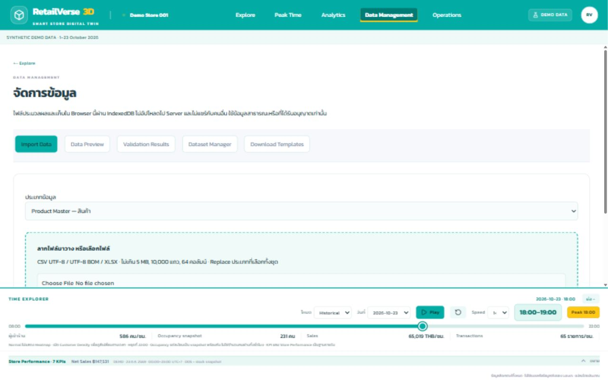
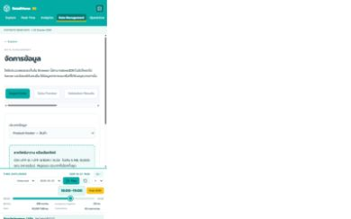
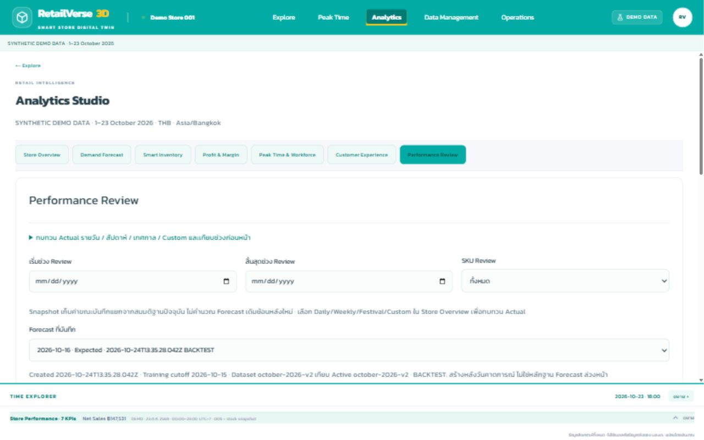
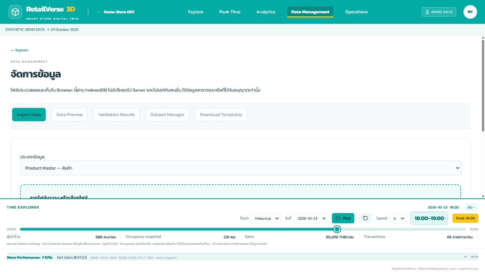

# Retail Intelligence Enhancement — รายงานตรวจรับ

วันที่ตรวจ: 24 ตุลาคม 2026 (Asia/Bangkok) · ขอบเขต: Portfolio / Browser demo

## 1. Repository Audit Summary — PASS

พัฒนาต่อจาก RSIP เดิม บน Next.js static export ใช้ Provider และ Workspace เดิม ไม่เพิ่ม backend, authentication หรือ top-level route ใหม่ ดูรายละเอียดใน [audit](retail-intelligence-audit.md)

## 2. Existing Features Reused — PASS

คง Explore, Peak Time, Analytics, Data Management, Operations รวม 5 เมนู; A–N, 53 Fixtures, geometry/camera/Inspector/Font Awesome เดิม; CSV/XLSX + mapping + validation + IndexedDB; AnalyticsView, InventoryPlanner และ ActionPlanning เดิม การทดสอบเดิมทั้ง 90 กรณียังอยู่

## 3. Files Modified — PASS

- Data: `src/data/mock/october.ts`, `src/data/providers/index.ts`, types และ import schemas/templates/validation/provider/persistence
- Engines: `src/lib/analytics/intelligence.ts`, `workforce.ts`, `operations.ts`, `catalog.ts`, `spatial.ts`
- UI: AnalyticsWorkspace, WorkforcePanel, CustomerPanel, StaffHub, IntelligenceUI, useForecast, ActionPlanning, Workspace, HomeWorkspace, Timeline, PeakAnalytics
- State/styles: intelligence/spatial stores, `intelligence.css` ซึ่งจำกัดขอบเขต, layout import stylesheet
- QA: `tests/retail-intelligence.test.ts` และภาพหน้าจอในเอกสารนี้

## 4. Analytics 7 Modules — PASS ในขอบเขต MVP

| Module | ผลตรวจ |
|---|---|
| Store Overview | Daily, same weekday, WTD, Weekly, Festival, Custom; สัปดาห์เริ่มจันทร์; เทียบจำนวนวันตรงกัน; บอก Coverage; Sales/GP/Margin/Transactions/OOS; target ไม่บังคับ; ตัวกรอง Zone และหมวดรวมถึงหมวดย่อย |
| Demand Forecast | Same weekday 4 observations ล่าสุด; Training cutoff; Horizon 1–7; Calendar normalization; override ไม่คูณเทศกาลซ้ำ; Manual fallback; Conservative/Expected/Optimistic; ราย SKU/วัน; Snapshot ถาวรใน Browser |
| Smart Inventory | Forecast + Shelf/Backroom/Reserved; Lead time + Review; ETA; แยกเติมชั้นและสั่งซื้อ; Capacity; Days supply; Closing estimate; เลือกหลาย Fixture และ Focus ของเดิม |
| Profit & Margin | ใช้ SKU และ Forecast ร่วมกัน; price/cost จาก Active Dataset; supply constraint; discount/uplift; stock investment แยก COGS; waste/labor/campaign/other; contribution/incremental/break-even; ไม่แก้ Actual |
| Peak Time & Workforce | Day-hour grid, previous/current/next weekday, Zone ranking; Historical/Forecast; สูตร workload/capacity; additional staff/cost/Monitor/Standby/Reinforce; Focus Zone/hour และสร้างงาน |
| Customer Experience | CSAT และ complaint rate ตาม Coverage; Quick Reports/Imported Cases; หมวด/สถานะ/resolution time; สร้าง Action; แสดง Feedback โดยไม่เก็บ PII |
| Performance Review | Snapshot เดิมเทียบ Active Actual ใหม่; Date/SKU filters; Actual period review พร้อม daily/weekly/festival/custom; Sales/Quantity/GP/Margin/variance; Stock snapshot; Closing เฉพาะข้อมูลที่ระบุ `isClosingSnapshot=true`; Waste เมื่อมีข้อมูล; ไม่มี Actual แสดง No Data |

## 5. Data Management Integration — PASS

คง 5 Tabs เดิม เพิ่ม Supply, Workforce, Feedback, Business Calendar, Waste รวม 10 ประเภท รองรับไฟล์เดิมโดย optional fields ไม่บังคับให้แก้ไฟล์เก่า Incoming ใหม่แทนค่ากำลังเข้าเดิมเพื่อไม่รวมซ้ำ Product replacement ตรวจ reference ของ Supply/Waste/Calendar เพิ่มด้วย วันที่ Coverage รองรับ ETA และ Calendar

Reset Demo กลับข้อมูลตุลาคมและ Historical; ไม่ใช้ Quick Report ก่อน Reset มาปรับสต็อกซ้ำ แต่เก็บประวัติรายงาน/Forecast ไว้ ข้อมูลนำเข้าเก็บแยกและสลับกลับได้

## 6. October Demo Dataset — PASS

Actual สังเคราะห์ 1–23 ต.ค. 2026 รวม 23 วัน มีรายการขาย quantity/transaction/price/discount/cost เพื่อคำนวณยอด ไม่มี Actual วันที่ 24 หรืออนาคต เพิ่มสินค้าเจ 13 SKU บน Fixture เดิม รวม 65 SKU และเก็บสินค้าเดิมครบ 52 SKU Traffic 4,830 แถว (23 × 15 ชั่วโมง × 14 Zone) พร้อม Workforce/Calendar/Experience และ stock snapshots รายวัน

เทศกาล 10–18 ต.ค. ตาม [TAT](https://www.tatnews.org/2026/10/thailand-celebrates-vegetarian-festival-2026-across-the-country/) เตรียมงาน 8–9 ต.ค. เป็นสมมติฐาน Demo ค่า uplift ทั้งหมดเป็นสมมติฐาน ไม่ใช่สถิติจาก TAT แต่ละวันมียอดและ mix ต่างกัน ยอด Sales/COGS ตรวจตรงกับ raw cents

## 7. 3D Integration — PASS

ไม่แก้ geometry หรือย้าย Fixture ตรวจ equality กับแปลนเดิม มี Historical/Forecast แยกชุด Occupancy คาดการณ์ไม่ถูกเรียกว่า Actual Sales หรือผู้เข้าร้านไม่ซ้ำ Incoming/OOS ใช้ข้อมูล Provider เดียวกัน รายงานที่อนุมัติเปลี่ยน Shelf/Backroom/Inspector/OOS; เก็บ stock time เป็น Bangkok และไม่แก้ Sales

## 8. Peak Time / Workforce Integration — PASS

Forecast occupancy ใช้ประวัติ weekday/hour และ normalize Calendar ก่อนคำนวณ ไม่ใช้ค่าคาดการณ์เป็นประวัติของตัวเอง Required = ceil(workload / productive minutes); Additional = max(0, required − available); extra labor = Additional × hourly cost มีสมมติฐาน service/restocking แสดงใน UI กดใช้ข้อมูล Workforce ที่นำเข้าได้ Forecast เพิ่มงานเติมจาก forecast units/ชั่วโมง × 0.3 นาทีต่อชิ้น (สมมติฐาน)

## 9. Store Staff Hub — PASS ใน Demo

My Tasks เชื่อมสถานะกับ Action Planning; Quick Report ตรวจ SKU/Fixture/capacity/จำนวนเติม/เวลา/stock ล่าสุด แล้วรอ Manager/Supervisor อนุมัติ; พนักงานกดอนุมัติไม่ได้ใน Demo UI; Digital Learning มี 5 บทตามหัวข้อที่ขอ; Feedback & Pain Points มีสถานะ; รองรับ 4 Demo roles โดยระบุชัดว่าไม่ใช่ production auth

## 10. Data Management Padding — PASS

Desktop ตรวจที่ 1280×800: container 28px / card 24px; Mobile 390×844: 16px / 16px; field/section spacing 16/24px; Tabs เลื่อนแนวนอนและ table เลื่อนภายใน ไม่มี document horizontal overflow พื้นที่ form scroller สิ้นสุดตรง Timeline เริ่ม (ต่างกัน <0.01px) จึงไม่ซ้อนทับ ทั้งขยายและพับ Timeline ใช้งานได้

## 11. Automated Test Results — PASS

รอบสุดท้าย: 114/114 PASS, 0 failed, 0 skipped (รวมการทดสอบ confirmed closing และ Waste) การทดสอบใหม่ครอบคลุม October reconciliation, category/week alignment, cutoff leakage, Calendar double effects, scenarios, timely incoming, reserved/capacity, loss/zero denominator, workforce, immutable variance, report approval/reset, imported data integration และ IndexedDB persistence

Browser-assisted checks (ไม่อ้างว่าเป็น automated E2E suite): 5 top menus / 7 Analytics tabs; การเลือกเต้าหู้ร่วม Forecast/Profit; ส่งรายงาน → Pending → Approve → Shelf 5/Backroom 44; Reset → Shelf 0/Backroom 46; Staff approve disabled; Learning 1/5; Feedback → CX; CX Action; Snapshot save; Backtest วันที่ 16–22 โดย cutoff 15 เทียบ Actual ได้จริง; Future Actual = No Data; Error Horizon 0 ห้าม Save; Confirmed closing ที่ไม่มี flag เป็น No Data; Forecast focus วันที่ 25 ตรง Timeline; playback ถึง 22:00 แล้วหยุด; ไม่มี console error ในรอบตรวจ

แก้ช่องวันที่ให้ใช้ input event เพื่อคำนวณทันที และรวมการเปลี่ยนสมมติฐานกับ state ล่าสุด ป้องกันค่าเก่าทับค่าที่เพิ่งกรอก

## 12. Production Build — PASS

Build รอบสุดท้ายหลังแก้ช่องวันที่และเพิ่ม closing flag ผ่าน static export ทั้ง `/` และ `/operations/action-planning` โดยไม่เพิ่ม runtime server TypeScript และ Lint ผ่าน ไม่มี lint warning/error ไฟล์ export ที่ใหญ่ที่สุด 5.8 MB

## 13. Known Limitations — ขอบเขตที่แสดงใน UI

- เป็นข้อมูลสังเคราะห์และแบบจำลองเพื่อสาธิต ไม่ใช่ POS/ERP/stock movement ledger จริง
- Forecast ไม่ใช่ ML; ±20% เป็นช่วงสมมติฐาน ไม่ใช่ statistical confidence interval ประวัติไม่พอแสดง Manual หรือ No Data
- Inventory protection เกิน forecast horizon ใช้ค่าเฉลี่ยและแจ้งผู้ใช้ Closing estimate เป็นยอดรวมช่วง ไม่จำลอง lost sales ระหว่างวันหรือรับประกันว่า ETA ป้องกันขาดชั่วคราว
- Stock Snapshot ทั่วไปไม่ถูกอ้างว่าเป็นยอดปิดบัญชี จะเป็น Confirmed Closing เฉพาะไฟล์ที่ระบุ flag นั้น Waste ที่ไม่มีข้อมูลแสดง No Data
- Imported cases เป็นข้อมูลต้นทางอ่านอย่างเดียว; ส่ง Action/ติดตามงานได้ แต่ไม่เขียนสถานะกลับไปทับไฟล์ต้นทาง ปิด Quick Report หลังแก้ไขได้ใน Operations
- เก็บเฉพาะ Browser นี้ จำกัด 50 Forecast snapshots / 1,000 reports; ไม่ sync หลายคนหรือหลายเครื่อง; Demo role ไม่ใช่ security boundary; ความคืบหน้าบทเรียนเก็บเฉพาะ Session
- Backtest ที่สร้างหลังวันขายมีป้ายชัดเจน ไม่อ้างว่าเป็น Forecast ล่วงหน้า Snapshot จาก dataset reference เดิมยังเลือกเทียบกับ Active Dataset ใหม่ได้ โดยแสดงทั้งสอง reference; SKU ไม่มี Actual ไม่เดาเป็นศูนย์

## 14. Git / Push / Deployment — PASS

Branch `feature/retail-intelligence-enhancement`:

- `412fe58` Stage 0 audit
- `a49af51` Stage 1 data foundation
- `93953fd` core intelligence engines และทดสอบ
- `907cb32` เชื่อม Analytics/3D Workforce/Staff Operations (Stage 2–4)
- `11c182a` Stage 5: date event/confirmed closing/error handling และผลทดสอบ 114 กรณี
- เอกสารตรวจรับและภาพ Desktop/Mobile/Review อยู่ใน commit เอกสารถัดไป

Production ใช้ branch `feature/phase5-product-inventory` → Cloudflare Pages `rsip.pages.dev` Push ทั้งสอง branch แบบ fast-forward สำเร็จที่ `11c182a`; Cloudflare Pages check = completed/success และตรวจ Production [rsip.pages.dev](https://rsip.pages.dev/?view=analytics) แล้ว: 7 Analytics tabs, October source, การเปลี่ยน Training cutoff/start คำนวณวันที่ 16 ต.ค. จริง และ 10 import types ไม่มี console error ในการตรวจหน้า Analytics/Data Management ผลนี้ตรวจจากเว็บจริง ไม่อ้างเพียงจาก Push สำเร็จ

[Cloudflare check ของ app commit](https://dash.cloudflare.com/?to=/865862ff8df66a060eedaf05759a2dcf/pages/view/rsip/d29cca1c-4e96-4a24-a8c7-21dd7f5317ff) · commit เอกสารถัดจากนี้เพิ่มผลตรวจและรูปเท่านั้น ไม่มีการเปลี่ยน application code

## 15. วิธีทดลองภายใน 10 นาที

1. นาที 0–1: Data Management → Dataset Manager → Reset Demo กลับ October; เปิด Store Overview ดู WTD 19–23 เทียบ 12–16 และเลือก Daily/Weekly ได้
2. นาที 1–3: Demand Forecast เลือกเต้าหู้ (`VEG-006`), วันที่เริ่มหลัง cutoff, Horizon 7 วัน ดู History/Manual/Scenario แล้วบันทึก Snapshot; ข้อมูลจริงมีถึง 23 ต.ค. เท่านั้น
3. นาที 3–4: Smart Inventory ดู Shelf/Backroom/เติม/สั่งและ Closing; เลือก Fixture แล้ว Focus 3D ถ้าสั่ง 0 แปลว่าสต็อกพอ ไม่ได้บังคับให้ซื้อเพิ่ม ทดลอง Manual demand สูงขึ้นเพื่อเห็นผลการสั่ง
4. นาที 4–5: Profit & Margin ใช้ SKU เดิม กดใช้จำนวนสั่งจาก Inventory ทดลองส่วนลดและค่าแรง แยก Stock Investment/COGS/Contribution แล้วเทียบ Baseline
5. นาที 5–6: Peak Time & Workforce เลือก Historical/Forecast, Zone/Hour ทดลองเพิ่ม workload แล้วดู Required/Additional/Cost จากนั้นสร้าง Operations Task และ Focus 3D
6. นาที 6–8: Operations → My Tasks รับงานเป็น In progress → Quick Report เลือก SKU/Fixture นับหลังเติม กรอกจำนวนเติมและเวลา → ส่ง Pending; สลับ Store Manager แล้วอนุมัติ ตรวจ Inventory/OOS เปลี่ยนและ Sales เดิมไม่เปลี่ยน
7. นาที 8–9: Customer Experience ดูรายงาน/Feedback สร้าง Action; Operations ดู Action Planning และเรียน 1 บท
8. นาที 9–10: Performance Review เลือก Snapshot ดู Future Actual เป็น No Data หรือทดลอง Backtest cutoff 15 ต.ค. / start 16 ต.ค. แล้วบันทึกใหม่ จะเทียบ Actual 16–22 ได้พร้อมป้าย BACKTEST ไม่อ้างว่าเป็น Forecast ล่วงหน้า

