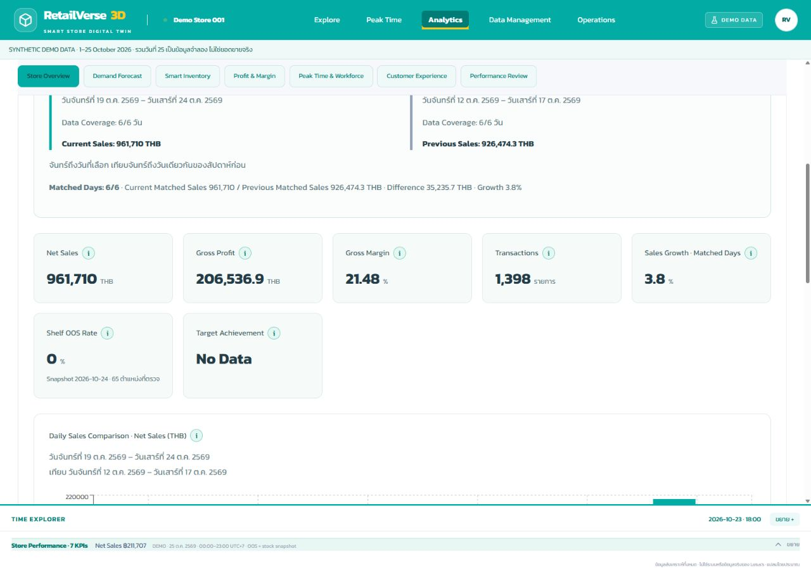
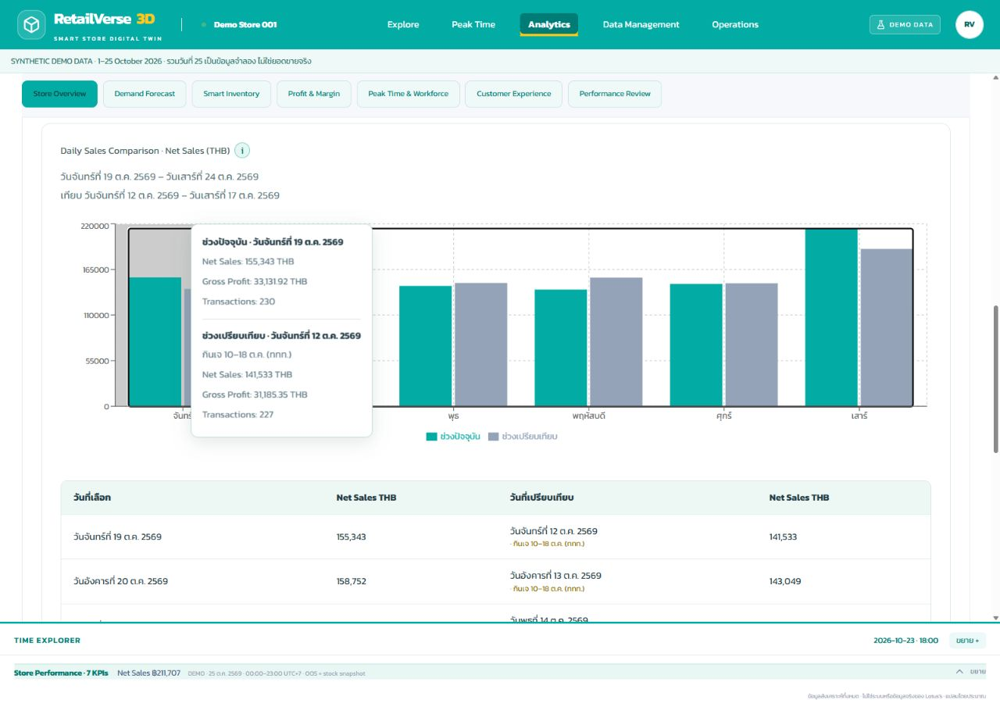
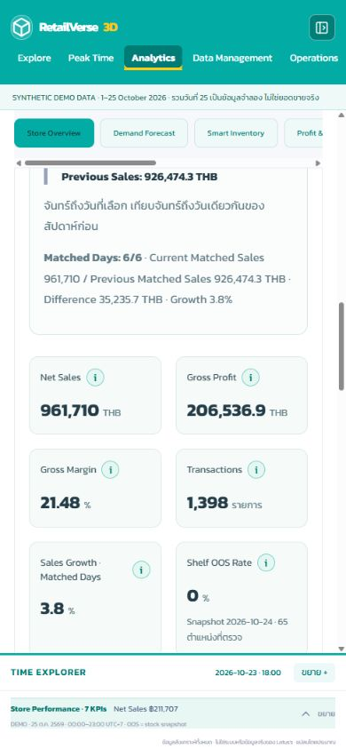

# Store Overview — รายงานแก้ไขและตรวจรับ

ตรวจวันที่ 24 ตุลาคม 2569 · สถานะ: PASS ตามขอบเขต Store Overview และ Data Foundation ที่จำเป็น

## 1. ปัญหาที่ตรวจพบ

- Active Imported Dataset ที่มี Sales เพียงวันเดียวไม่พอเทียบ WTD แต่ผู้ใช้ยังไม่มีทางเลือก Demo ที่เห็นชัดในหน้า Overview
- ข้อความ WTD ถูกใช้ประกอบทุกโหมด ไม่มี Comparison Summary ที่แยกยอดสองช่วง, Difference และ Coverage สองฝั่ง
- Same Weekday ใช้กราฟทั่วไป แกนแสดงวันที่ปัจจุบันเพียงฝั่งเดียว ไม่แสดงวันที่ก่อนหน้าเป็นสองแท่งตามที่ต้องการ
- Festival ถูกกำหนดวันที่ตายตัวและเปรียบเทียบกับ `prior` ที่อิงสัปดาห์ ไม่ได้สร้าง normal-day benchmark ที่เหมาะสม
- Shelf OOS ใช้ `catalog.shelfInventory` ล่าสุด แม้เลือกวันย้อนหลัง
- Overview ใหม่ไม่มีปุ่มสูตร KPI ส่วน Dashboard เดิมที่ซ้อนด้านล่างมีตัวกรองอีกชุด ซึ่งไม่เชื่อมกับชุดแรก
- Demo เดิมมี 23 วัน ยังไม่ครบ 25 วันตามคำขอใหม่นี้

## 2. Root Cause ของ WTD

สูตร Monday/start และ previous-week offset เดิมถูกต้องอยู่แล้ว ปัญหาจริงคือข้อมูล Imported เพียงวันที่ 23, การสื่อสาร Coverage/วันที่ไม่ชัด และกราฟไม่มี tooltip แสดงวันจริงของทั้งคู่ ไม่ได้แก้โดยเอาข้อมูลจำลองไปเติมใน Imported Dataset ใหม่แยก Current/Previous Coverage และคำนวณ Growth เฉพาะ Matched Days

ผลตรวจ WTD วันที่ 24: 19–24 ต.ค. เทียบ 12–17 ต.ค.; 6/6 วันทั้งสองฝั่ง; Current 961,710 THB, Previous 926,474.30 THB, Difference 35,235.70 THB, Growth 3.80%

## 3. Root Cause ของ Same Weekday

Date Picker ร่วมมีอยู่แล้วและ offset −7 วันถูกต้อง แต่ label ไม่สื่อหน้าที่ของแต่ละโหมด และ generic chart ไม่แสดงวันที่ของสองแท่งอย่างชัดเจน เปลี่ยนเป็น date picker ที่ชัดเจน สองแท่งพร้อมวันที่จริงและ legend แยกสองฝั่ง

ตรวจ 21 ต.ค. (พุธ) เทียบ 14 ต.ค. (พุธ): 145,142 เทียบ 148,673 THB; ป้ายวันเทศกาลปรากฏใน Tooltip ของวันที่ 14

## 4. การแก้ Date Comparison

PASS ทุกโหมด:

- Daily: วันที่เลือก vs วันก่อนหน้า เช่น 20 vs 19 ต.ค.
- Same weekday: วันที่เลือก vs −7 วัน เช่น 21 vs 14 ต.ค.
- WTD: จันทร์ถึงวันที่เลือก vs ช่วง weekday ตรงกันของสัปดาห์ก่อน
- Weekly: เลือกวันในสัปดาห์ → จันทร์–อาทิตย์ vs สัปดาห์ก่อน; ข้อมูลไม่ครบแสดง Partial Week
- Festival: เลือกจาก Event Calendar; normal days มี weekday ตรงกัน ไม่ใช้วันซ้ำ และไม่อยู่ใน Calendar events อาจไม่ต่อเนื่อง มีรายการวันจริงและข้อจำกัดแสดงบนหน้า
- Custom: Start/End, ตรวจ Start <= End, previous equal-length period หรือระบุ comparison start แล้วคำนวณวันสิ้นสุดให้เท่ากัน

KPI/summary/table/chart ใช้ช่วงเดียวกัน Missing days = No Data; ตัวหารศูนย์ = No Data; Gross Margin = ผลรวม GP / ผลรวม Sales ไม่เฉลี่ยเปอร์เซ็นต์รายวัน OOS ใช้ snapshot ตรงวันที่สิ้นสุดของช่วง หากไม่มี snapshot วันนั้นจะไม่เอาค่าล่าสุดมาแทน

## 5. Demo October Dataset Summary

PASS: Synthetic Demo วันที่ 1–25 ต.ค. 2569 รวม 25 วัน มี transactions/unique IDs, SKU/quantity/price/discount/net sales/COGS จากรายการต้นทาง, daily stock snapshots, hourly traffic/occupancy/workforce ครบ 25 วัน สินค้าเดิม 52 + สินค้าเจเดิม 13 = 65 SKU ไม่ลบหรือเพิ่ม geometry

วันที่ 25 เป็นข้อมูลสมมติ ไม่ใช่ยอดขายจริงที่เกิดขึ้นแล้ว แสดงไว้ใน source label และหน้า Overview ข้อมูลรายวันแตกต่างกันตาม weekday/weekend, mix, เทศกาลและหลังเทศกาล

ใช้เทศกาล 10–18 ต.ค. ตามช่วงที่ [TAT ระบุสำหรับกรุงเทพฯ/ภูเก็ตและหลายพื้นที่](https://www.tatnews.org/2026/10/thailand-celebrates-vegetarian-festival-2026-across-the-country/) วันเตรียมงาน 8–9 และ uplift เป็นสมมติฐาน Demo ไม่ใช่สถิติจากแหล่งอ้างอิง

## 6. วิธีเลือก Demo / Imported Dataset

ที่ Analytics → Store Overview กด **ใช้ Demo ตุลาคม 2569** จะเปลี่ยน Active Provider เป็น Demo 25 วัน โดยคง imported bundle เดิมไว้ กด **กลับไปใช้ Imported Dataset** เพื่อคืนข้อมูลเดิม ถ้ายังไม่เคยนำเข้าปุ่มกลับจะปิดใช้งาน ไม่สลับให้เองและไม่ผสมค่าระหว่างแหล่ง

UI ทดสอบ Imported หนึ่งวัน 200 THB → Demo 25 วัน → Imported 200 THB อีกครั้ง จำนวนแถวและเวลานำเข้าเดิมตรงกันครบ

## 7. Info Icon Fix

PASS: ใช้ popover component เดิม เพิ่ม optional topic override เพื่อให้สูตรตรงกับ Overview โดยพฤติกรรมเดิมของหน้าอื่นยังอยู่ ครอบ label + ปุ่มใน inline-flex, align-items center, gap 6px, ปุ่มไม่หด อยู่ติดข้อความทุก KPI และ chart header มี accessible label, native button, Enter เปิด / Escape ปิด และคืน focus

วัด DOM ทั้ง Desktop และ Mobile: gap ≈6px, ความต่าง center แนวตั้ง 0px ทั้ง 10 หัวข้อ ตรวจเปิดสูตร Net Sales ได้จริง

## 8. Duplicate Dashboard Fix

PASS: หน้าหลัก Store Overview มี Dashboard และ Filter เพียงชุดเดียว ไม่ render "Dashboard และกราฟเดิม" รวมกราฟ Sales Comparison, Sales by Zone และ Peak Day ในชุดหลัก ไม่ลบ selectors/calculators/AnalyticsView ที่มีประโยชน์ หน้าทบทวนเดิมใน Performance Review ไม่ถูกแก้ในงานนี้

## 9. Shared Filter Fix

PASS: เก็บ Time Mode, Selected Date, Custom Start/End, Comparison, Event, Zone, Category และ Target ใน state เดียว Derive current/comparison periods และ model จาก object นี้ชุดเดียว รองรับหมวดหลัก/หมวดย่อย ทุก metric/coverage/zone chart เปลี่ยนตาม filter ไม่มี filter อีกชุดที่คุม Dashboard ซ้ำ

## 10. Files Modified / Scope

- `src/lib/analytics/overview.ts` — period resolution, coverage/matched comparisons, dated OOS, zone/category aggregates
- `src/components/analytics/StoreOverview.tsx` — scoped UI, dates, charts/tooltips, source switch and KPI help
- `src/app/overview.css`, stylesheet import ใน layout — ใช้ selectors เฉพาะ Overview ไม่เปลี่ยน global padding
- `AnalyticsWorkspace.tsx` — เชื่อมเฉพาะ Store Overview หลัก เปลี่ยน 1 import และ 1 component call
- `KPIInfoPopover.tsx` — optional help override และ aria-expanded โดยรักษา default เดิม
- `src/data/mock/october.ts` — default 25 วัน, dated synthetic source version; รองรับ fixture ประวัติ 23 วันเพื่อ regression
- `DataManagement.tsx` — เปลี่ยนเฉพาะข้อความ Reset จาก 1–23 เป็น 1–25 ไม่แตะ padding/workflow
- `tests/store-overview.test.ts` — 17 กรณีใหม่
- `tests/retail-intelligence.test.ts` — ระบุ fixture ประวัติ 23 วันเดิมให้ชัด เพื่อคง regression Forecast เดิม ไม่ลบหรือ skip tests

ไม่แก้ 3D geometry, Zone A–N, Fixture coordinates, camera controls, Time Explorer mechanics, Operations workflow หรือ UI ของ Analytics อีก 6 หน้า

## 11. Tests Results

PASS: **131/131**, failed 0, skipped 0; รวม 114 กรณีเดิมและ 17 กรณี Store Overview ใหม่

ครอบคลุม WTD, Same Weekday, Daily, Weekly/Partial Week, Missing Comparison, Festival/insufficient baseline, weighted Gross Margin, transaction deduplication, demo activation/import preservation, shared filters, exact-date OOS, target/zero denominator, info rendering และไม่มี Dashboard ซ้ำ รวม default Demo 25 วัน

Browser-assisted QA (ไม่อ้างว่าเป็น automated E2E suite): วันที่เปลี่ยนแล้ว model เปลี่ยนจริง; WTD/Daily/Same Weekday/Weekly/Festival/Custom; validation ช่วงกลับด้าน; Tooltip ทั้งสองวันพร้อม GP/transactions/festival; keyboard info; Imported→Demo→Imported; mobile390px ไม่ overflow; ไม่มี console error ในรอบตรวจ

## 12. Build Results

PASS: TypeScript, ESLint ไม่มี error/warning, Tests และ `npm run build` ผ่าน Static export `/` และ `/operations/action-planning` ใช้ระบบเผยแพร่เดิม

## 13. Git Status

Branch: `fix/store-overview-comparison` · Application commit: `1a2c799` · รายงาน/ภาพหลักฐานแยกใน commit เอกสารถัดไป Commit เฉพาะ scope นี้ ไม่ force push Production ใช้ branch เดิม `feature/phase5-product-inventory` การอัปเดตเป็น fast-forward หลังตรวจรับ ผลตรวจการเผยแพร่บน Cloudflare แจ้งในคำตอบปิดงาน

## 14. Known Limitations

- ข้อมูลทั้ง 25 วันเป็น Synthetic Demo โดยเฉพาะวันที่ 25 ซึ่งยังเป็นอนาคต ณ วันตรวจ ไม่ใช้เป็นหลักฐานผลขายจริง
- Festival baseline อาจเป็นวันไม่ต่อเนื่องและรวมวันที่หลังเทศกาล เป็น retrospective weekday-matched benchmark ไม่ใช่ causal lift หรือ forecast; หากข้อมูลไม่พอแสดง matched coverage และ No Data
- Coverage ถือว่ามีข้อมูลเมื่อมีรายการขายใน filter ของวันนั้น ไฟล์ Sales ที่ไม่มีแถวไม่อาจแยกว่ายอดเป็นศูนย์จริงหรือยังไม่นำเข้า จึงใช้ No Data อย่างระมัดระวัง
- OOS ใช้ snapshot วันสิ้นสุดช่วงที่มีหลักฐาน หากไม่มีวันที่ตรงกันแสดง No Data ไม่ carry forward; ไม่ใช่ค่าเฉลี่ย OOS ของช่วง
- การสลับแหล่งใช้ Browser/IndexedDB เดิม ไม่ใช่ระบบแชร์ข้อมูลระหว่างผู้ใช้ และไม่ล้าง imported bundle
